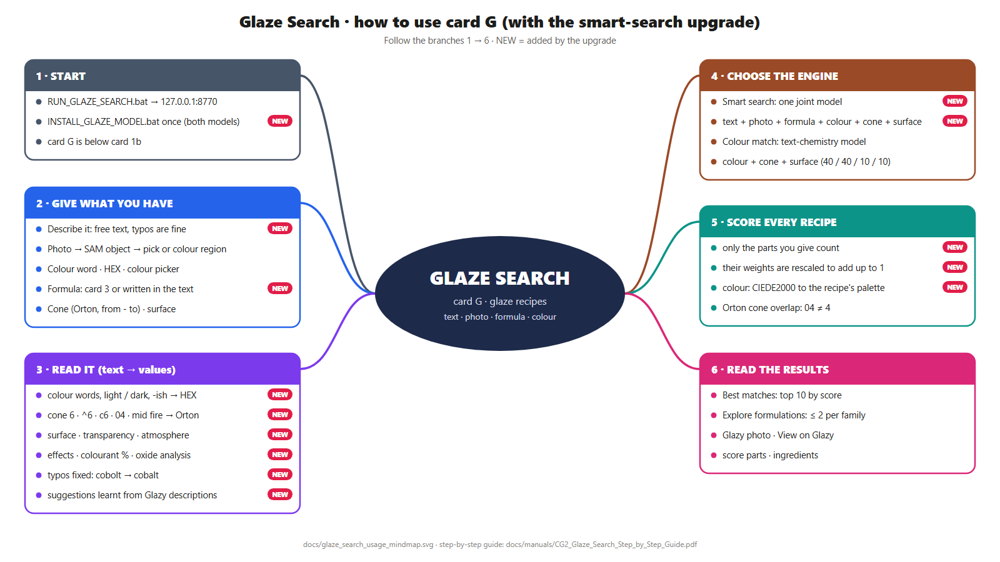
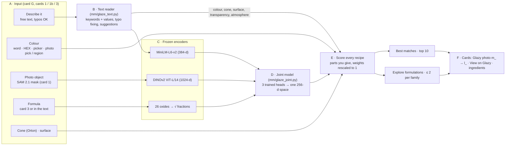

# Glaze recipe search (card G): smart search and colour match

Card G of the Glaze Search page (`RUN_GLAZE_SEARCH.bat`, http://127.0.0.1:8770) finds Glazy recipes from what a person
has: **their own words** (typos and shorthand are fine), **a colour**, **a photo object** (the existing SAM segmentation of
card 1) or **a glaze formula**. Two engines share the card:

- **Smart search** (default): one joint model for text + photo + formula, plus colour, cone and surface.
- **Colour match**: the text-chemistry retrieval model; one colour + cone + surface.

Both return two lists from one scoring pass, **Best matches** and **Explore formulations**. The rest of the page (object
search, cards 1 – 4, session evaluation) is unchanged.

| Document | For |
|---|---|
| [manuals/CG2_Glaze_Search_Step_by_Step_Guide.pdf](manuals/CG2_Glaze_Search_Step_by_Step_Guide.pdf) | users: every step with screenshots, noisy text → values |
| [manuals/CG2_Glaze_Search_Process_Models_MindMap.pdf](manuals/CG2_Glaze_Search_Process_Models_MindMap.pdf) | the process, the model and parameters of each step, test results |
| [glaze_search_usage_mindmap.png](glaze_search_usage_mindmap.png) · [glaze_search_full_flow.png](glaze_search_full_flow.png) | usage mind map · the three flows of the whole system |
| [glaze_integration_mindmap.svg](glaze_integration_mindmap.svg) | the seven stages of the first integration (colour match) |



## How it works



### Text reader (free text → keywords and values)

`extract(text)` reads what a person writes, tolerant to typos, shorthand, filler words and word order:

| Reads | Examples | Becomes |
|---|---|---|
| colour words, light / dark / pale / deep, -ish | `cobolt blu`, `Light Bluish Gray` | HEX (Color Lab V3 + the pipeline's 98 reference shades) and the model's nearest colour word |
| Orton cone or range | `cone 6`, `^6`, `c10`, `cone6`, `5-6`, `cone 04`, `mid fire` | `6`, `10`, `5 - 6`, `04` (low fire, never 4), `5 - 6` |
| surface, transparency, atmosphere | `shinyy`, `semi matt`, `clear`, `ox`, `reducton`, `soda fired` | Glossy, Semi-matte, Transparent, Oxidation, Reduction, Salt & Soda |
| glaze effects | `runny`, `crackle`, `speckled`, `oil spot` | flowing, crackle, speckled, oil spot |
| colourant amounts, oxide analysis | `8% red iron oxide`, `SiO2 64.2 Al2O3 13.1 …` | Fe2O3 8 %; an oxide analysis (≥ 3 oxides) used as the formula |

Typos: a word that is no keyword is matched to the nearest keyword or colour word (difflib ratio ≥ 0.80; ≥ 0.85 for words of
≤ 4 letters). **Suggestions**: TF-IDF (word 1–2 grams + character 3–5 grams) → logistic regression, trained on 4,766 recipe
descriptions written on Glazy, give the surface / transparency / atmosphere the words imply (`a celadon for my gas kiln` →
reduction 81 %, translucent 70 %); shown when p ≥ 0.45 and the value was not written; the person clicks to use them.

### Smart search model (joint text + photo + formula)

| Part | Setting |
|---|---|
| encoders (frozen, pretrained) | text: `sentence-transformers/all-MiniLM-L6-v2`, mean pooled, 384-d, ≤ 128 tokens · photo: DINOv2 ViT-L/14, 1024-d, area-weighted mean of the recipe's segmented objects · formula: 26 oxides → fractions → √ (26-d) |
| heads (trained) | Linear → GELU → Dropout 0.1 → Linear, hidden 512, output 256-d, L2-normalised |
| training text | per step: tag text 25 % (colour word + cleaned tags, Orton cones kept), the recipe's Glazy description 20 %, a noisy sentence 55 % (8 per recipe: typos, shorthand, filler, any order) |
| loss | symmetric InfoNCE, temperature 0.07, for text–photo, text–formula, photo–formula; recipes of the same composition group are not negatives |
| optimiser | AdamW, learning rate 1e-3, weight decay 1e-4, batch 256, early stop (patience 12) on the validation split: best epoch 58 of 70 |
| data | 7,063 recipes (7,052 with photo objects, 7,049 with a formula, 4,766 with a description); split 4,945 / 1,059 / 1,059 by composition group |
| families | K-Means on the fused 256-d embeddings, k by silhouette → 10. HDBSCAN found only 2 clusters with 35 % noise (no clear density groups), so it is not used |

**Score** (smart search): only the parts a query has count; their weights are rescaled to add up to 1.

| part | weight | value |
|---|---|---|
| text · photo · formula | 0.35 · 0.35 · 0.25 | (cosine to the recipe's fused embedding + 1) / 2 |
| colour | 0.30 | exp(−CIEDE2000 / 20) to the closest colour of the recipe's palette with ≥ 10 % of the area (two-colour tiles count) |
| cone · surface · transparency · atmosphere | 0.10 · 0.10 · 0.05 · 0.05 | 1 when they match (Orton cone ranges overlap; 04 ≠ 4) |

Weights are in [`configs/glaze_joint.json`](../configs/glaze_joint.json).

### Colour match model (text-chemistry retrieval)

The query text `color: {word}, Cone {cone}, {surface}, unknown, unknown` → frozen MiniLM → trained text head → cosine with
the precomputed chemistry vectors of 6,718 recipes (oxides → PCA-16 → chemistry head). Score: 0.40 latent + 0.40 colour
(exp(−ΔE00 / 20)) + 0.10 surface + 0.10 cone ([`configs/glaze_retrieval.json`](../configs/glaze_retrieval.json)).
`mm/glaze_retrieval.py` reproduces the original notebook exactly (same lists, scores within 1e-5).

**Cone 04 is not cone 4.** The colour-match catalog lost the leading zero of 234 low-fire recipes (04 → 4; 56 of its 60
"cone 4" recipes are cone 04). `cone_scoring: "orton"` (default) uses the original cone text of the 7k recipes and reads a
leading zero as low fire; `"notebook"` keeps the original parser for the parity test. Its latent part learnt the text without
the zeros; the smart search model was trained on the cleaned tags, which keep them.

## Data

| File | Where | Used for |
|---|---|---|
| recipe bank `recipes.csv`, `objects.csv`, DINOv2 object cache | `multimodal_experiments\work\data`, `multimodal_experiments\cache` (DOWNLOAD_DATA.bat) | training the smart search model |
| `glaze_retrieval_catalog.csv`, `glaze_retrieval_vectors.npz`, `shared_space_heads.pt` | `multimodal_experiments\models\glaze_retrieval\` (from the model ZIP) | colour match; Glazy photo links |
| `heads.pt`, `gallery.npz`, `text_tags.joblib`, `meta.json` | `multimodal_experiments\models\glaze_joint\` (trained on this PC) | smart search; every test result is in `meta.json` |
| `7k_matched_all_data.csv`, `7k_matched_ingredients.csv` | `<CG2>\`, `<CG2>\new image data\csv 7k data\` or `CG2_7K_CSV_DIR` | recipe names, original cone text, dropdown values, ingredients (read-only) |

Checkpoints load with `torch.load(weights_only=True)`; the model ZIP's `glaze_chemistry_models.joblib` is never loaded.
`models\` is not in git.

## API (app/server.py)

| Endpoint | Does |
|---|---|
| `GET /api/glaze/options` | cone / surface choices with counts, colour words, weights, model versions, the smart model's test results |
| `GET /api/glaze/color_name?hex=3054A5` | nearest colour word of the colour-match model |
| `POST /api/glaze/understand` `{"text": "…"}` | the text reader: colour, cone, surface, transparency, atmospheres, effects, colourants, oxides, corrections, unused words, suggestions |
| `POST /api/glaze/smart_search` | smart search (below) |
| `POST /api/glaze/search` `{"hex", "color_name", "cone", "surface", "top_k"}` | colour match |

`POST /api/glaze/smart_search` takes any of `text`, `hex`, `cone`, `surface`, `transparency`, `atmospheres`,
`use_photo` + `qid` + `object` (an object of a card-1 upload), `oxides` + `oxide_unit` (`wt` or `umf`), `top_k`, `weights`.
Values written in the text fill the ones not given. A real response (shortened to one result and two ingredients):

```json
{
  "query": {"text": "shinyy cobolt blu glaze ^6 ox", "hex": "#0047AB", "cone": "6", "surface": "Glossy", "atmospheres": ["Oxidation"]},
  "understood": {"colour": {"hex": "#0047AB", "words": "cobalt blue"}, "cone": {"value": "6", "evidence": "^6"},
                 "surface": {"value": "Glossy", "evidence": "shinyy"}, "atmospheres": [{"value": "Oxidation", "evidence": "ox"}],
                 "corrections": [["shinyy", "shiny"], ["cobolt", "cobalt"], ["blu", "blue"]]},
  "parts": {"text": 0.3889, "colour": 0.3333, "cone": 0.1111, "surface": 0.1111, "atmosphere": 0.0556},
  "weighted_results": [{
    "rank": 1, "recipe_id": 482955, "recipe_name": "crystalline #3 blue chiaro", "recipe_url": "https://glazy.org/recipes/482955",
    "image_url": "https://cdn.glazy.org/public/uploads/recipes/55/l_482955.666307ddbd001.jpg",
    "thumb_url": "https://cdn.glazy.org/public/uploads/recipes/55/m_482955.666307ddbd001.jpg",
    "hex": "#254996", "color_name": "cobalt blue", "cone": "6 - 7", "surface": "Glossy", "transparency": "Translucent", "atmospheres": "oxidation",
    "similarity_score": 0.859454,
    "score_components": {"text": 0.7608, "colour": 0.8574, "cone": 1.0, "surface": 1.0, "atmosphere": 1.0, "delta_e_2000": 3.08},
    "contributions": {"text": 0.2959, "colour": 0.2858, "cone": 0.1111, "surface": 0.1111, "atmosphere": 0.0556},
    "cluster_id": 6,
    "ingredients": [{"name": "Ferro Frit 3110", "percent": 53.3, "addition": false}, {"name": "Zinc Oxide", "percent": 24.0, "addition": false}]
  }],
  "diverse_results": [],
  "model_version": "78afd7dfbe2c", "max_per_cluster": 2, "searched": 7063, "timings": {"retrieval_ms": 23.9, "total_ms": 23.9}
}
```

Missing values are `null`, never invented. Errors: `400 {"error": …}` for a bad HEX / cone / surface / weights or an empty
query; `503` with "run INSTALL_GLAZE_MODEL.bat" when a model is not installed. Each search adds a line to
`work\queries\glaze_search_log.jsonl`; the object search's session log is not touched.

## Running and updating (Windows)

1. Once: drag the model ZIP onto **`INSTALL_GLAZE_MODEL.bat`**. It installs the colour-match files (after the same checks as
   at start-up; the old model stays if one fails), then trains and tests the smart search model (`scripts\train_glaze_joint.py`,
   about 2 minutes with an NVIDIA GPU).
2. **`RUN_GLAZE_SEARCH.bat`** as before; the window prints `Glaze recipe model ready` and `Smart search model ready`.
3. Tests: `cd multimodal_experiments`, then `..\.venv\Scripts\python.exe -m unittest tests.test_glaze_retrieval tests.test_glaze_smart -v`.

A new model ZIP: run `INSTALL_GLAZE_MODEL.bat` with it, then `scripts\build_glaze_golden.py "<zip>"` (re-runs the
notebook's retrieval cells and rewrites the golden results of the parity test), then the tests. The page does not change.

## Files

| File | Change |
|---|---|
| `multimodal_experiments/mm/glaze_text.py` | new: text reader, noisy-sentence generator, suggestion model |
| `multimodal_experiments/mm/glaze_joint.py` | new: joint model (data, heads, training, evaluation, search) |
| `multimodal_experiments/mm/glaze_retrieval.py`, `glaze_reference.py` | colour match; 7k reference data, cone / surface normalisation |
| `multimodal_experiments/app/server.py` | + 5 routes; both models load at start-up (a missing model leaves the rest working) |
| `multimodal_experiments/app/index.html` | card G (Describe it, Smart search / Colour match, two tabs); picker = 13 × 13 trimmed median; **Use for glaze search**; **glaze** per colour region; card 1b shows the object clicked last (fixes a race when objects are clicked quickly) |
| `scripts/train_glaze_joint.py`, `install_glaze_model.py`, `build_glaze_golden.py`, `INSTALL_GLAZE_MODEL.bat` | train / install / update the models |
| `configs/glaze_joint.json`, `configs/glaze_retrieval.json` | weights and settings |
| `multimodal_experiments/tests/test_glaze_smart.py`, `test_glaze_retrieval.py` | 38 tests |

No new Python packages.

## Test results (2026-11-04, Windows 11, Python 3.11, torch 2.11 + CUDA)

Smart search model, on the **held-out test split** (1,059 recipes it never saw; random top 10 ≈ 0.9 %):

| query → recipe | top 1 | top 10 | median rank |
|---|---|---|---|
| noisy sentence → recipe, all parts | 31.7 % | **74.2 %** | 3 |
| noisy sentence → recipe text, pretrained MiniLM only (no training) | 24.5 % | 62.0 % | 5 |
| photo object → recipe | 14.3 % | 45.3 % | 14 |
| tag text → recipe (photo + formula side) | 9.9 % | 40.2 % | 16 |
| real Glazy description → recipe | 7.7 % | 33.4 % | 31 |
| formula → recipe | 6.6 % | 33.1 % | 26 |

| check | result |
|---|---|
| text reader on 1,059 noisy test sentences (15 % typos): right when read | colour 93.3 % · cone 99.2 % · surface 89.1 % · atmosphere 100 % |
| full smart search, 300 noisy test sentences: top 10 matching colour + surface + cone | text model only 54.4 % · read values only 55.3 % · **both 73.1 %** |
| suggestions (held-out descriptions) vs always the most common value | surface 63 % vs 53 % · transparency 68 % vs 48 % · atmosphere 93 % vs 88 % · colour family 37 % vs 37 % (not used) |
| colour match vs the original notebook | same lists, scores within 1e-5 |
| unit + API tests | 38 / 38 pass |
| browser (headless Edge driving the page): describe → read → search, photo → select object → pick → regions → use for glaze search → smart search, tabs, formula search | all steps pass, 0 JavaScript errors |

Speed: about 25 ms per search (7,063 recipes, CPU); the model loads in 0.3 s; training takes about 2 minutes.

## Known limitations

- Noisy test sentences are generated from the recipes' tags; real user text can be more varied.
- A recipe has one palette from its photo objects; glazes change with thickness, clay body and firing.
- The colour-match model's latent part learnt cones without leading zeros; only retraining fixes it.
- Formula → recipe finds similar chemistry, not a guaranteed colour: colour depends on firing and application too.
- Photos come from Glazy's server and need internet; the search itself runs offline.
- On a photo without pottery, SAM still returns its best object with a low ceramic score (the page shows it).
