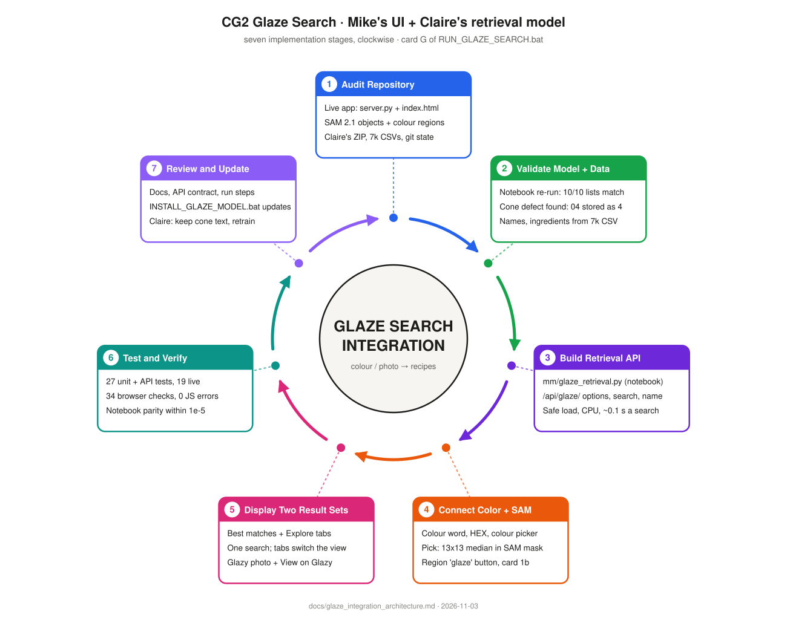
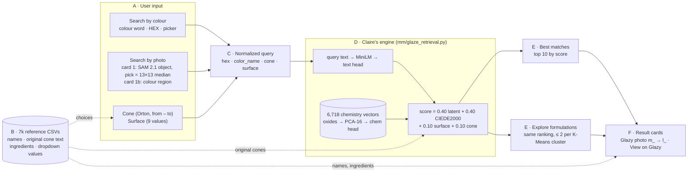

# Glaze recipe search (card G): Claire's model in Glaze Search

Card G of the Glaze Search page (`RUN_GLAZE_SEARCH.bat`, http://127.0.0.1:8770) sends **one colour + a firing cone +
a surface** to Claire's retrieval model and shows two lists of Glazy recipes: **Best matches** and **Explore formulations**.
The colour comes from a colour word, a HEX code, the colour picker, or a pick on an uploaded photo (the existing SAM
segmentation). The rest of the page (object search, cards 1 – 4, session evaluation) is unchanged.



## How it works



1. **Input.** Both ways in produce the same query. *By colour*: a colour word (Claire's 90 words, or a Color Lab V3 word
   whose HEX is used), a HEX code or the colour picker. *By photo*: in card 1, **Pick colour (HEX)** takes the median of
   13 × 13 pixels inside the SAM outline under the cursor, after leaving out the brightest and darkest 15 % (reflections,
   shadows); **Use for glaze search** sends it to card G. In card 1b, **glaze** next to a colour region sends that
   region's colour (median Lab of the region). The HEX can be corrected by hand before searching.
2. **Normalization** (`mm/glaze_reference.py`). HEX → `#RRGGBB`; colour word = the user's word, else the nearest of the
   model's 90 colour words (CIEDE2000 to their reference swatch); cone → an Orton cone or range (`04`, `5 1/2`,
   `5 - 6`; anything else is refused); surface → one of the 9 values (`gloss` → Glossy, `semi gloss` → Semi-glossy;
   Glossy and Semi-glossy are never merged). "Any" cone / surface becomes `unknown`, Claire's word for a missing field.
3. **Retrieval** (`mm/glaze_retrieval.py`, a port of the retrieval cell of Claire's notebook): the text
   `color: {word}, Cone {cone}, {surface}, unknown, unknown` → frozen MiniLM (mean pooled) → Claire's text head →
   cosine with every recipe's chemistry vector. Every recipe is scored (no shortlist).
4. **Two lists from one scoring pass.** *Best matches* is the top of the ranking. *Explore formulations* walks the same
   ranking and keeps at most 2 recipes per K-Means chemistry cluster (12 clusters of the training-only PCA of the oxides).
   K-Means only picks; it never changes a score. Different chemistry does not mean safer or better.
5. **Cards.** Photo straight from Glazy's server in the browser (the `m_` size, about 35 % of the bytes of the catalog's
   `l_` link, which is the fallback), recipe name, cone, surface, colour and ΔE00, score and its four parts, K-Means
   cluster, ingredients, **View on Glazy** (`https://glazy.org/recipes/{recipe_id}`).

### Score

| part | weight | value |
|---|---|---|
| latent | 0.40 | (cosine(text, chemistry) + 1) / 2 |
| colour | 0.40 | exp(−CIEDE2000(query HEX, recipe HEX) / 20) |
| surface | 0.10 | 1 if the recipe's surface is the query's word (case-insensitive), else 0 |
| cone | 0.10 | 1 if the recipe's cone range overlaps the query's, else 0 |

A missing value counts 0 (as in the notebook). Weights, `max_per_cluster` and `top_k` are in
[`configs/glaze_retrieval.json`](../configs/glaze_retrieval.json); restart the server after a change.

## Cone 04 is not cone 4

Orton cones with a leading zero are low fire (022 … 01), without it mid / high fire (1 … 14): cone 04 (earthenware) is
about 100 °C below cone 4. Claire's `training_data.csv` lost the zero (`04` → `4`, `05 1/2 - 03` → `5.5 - 3`) for
**234 of the 6,718 recipes**; 56 of the 60 recipes it lists as "Cone 4" are cone 04. Her cone parser also reads a typed
`04` as 4.

`cone_scoring` in the config:

| value | cone part of the score | used for |
|---|---|---|
| `orton` (default) | the original cone text of the 7k CSV (by `recipe_id`); a leading zero is negative (`04` → −4, `05 1/2` → −5.5), so ranges compare in firing order | the app |
| `notebook` | Claire's parser and catalog cones exactly | the parity test |

Measured (top 10, Best matches): a cone 06 search had **0** low-fire glazes with the notebook scoring and **6** with
`orton`; a cone 4 search went from 6 low-fire glazes to 4; Claire's five cone-6 example queries are unchanged except one
recipe of one list. The latent part (40 %) was trained on the text without the zeros, so a full fix needs Claire to keep
the cone column as text in `training_data.csv` and retrain.

## Data

| file | where | used for |
|---|---|---|
| `glaze_retrieval_catalog.csv`, `glaze_retrieval_vectors.npz`, `shared_space_heads.pt` | `multimodal_experiments\models\glaze_retrieval\` (from Claire's ZIP, not in git) | the model: catalog (photo URL, colour, cone, surface, K-Means cluster), 256-d chemistry vectors, text head |
| `7k_matched_all_data.csv` | `<CG2>\`, `<CG2>\new image data\csv 7k data\`, or `CG2_7K_CSV_DIR` | recipe names (the catalog has none), the original cone text, the cone and surface choices with their counts. Read-only; it is not a second catalog. |
| `7k_matched_ingredients.csv` | same | the ingredients on the cards |
| `glaze_chemistry_models.joblib`, `training_data.csv`, the notebook | Claire's ZIP only | not needed by the app (the K-Means labels are in the catalog); the joblib pickle is never loaded |

Without the 7k CSVs card G still works: no names, no ingredients, and the cone part uses the catalog's cones (a warning
is shown). Claire's checkpoint is loaded with `torch.load(weights_only=True)` and an allowlist of numpy array types, so
no code inside it runs. The model version is the first 12 hex digits of a SHA-256 over the three files (`70cd01c0c673`
for `test_similarity (2).zip`).

## API

All on the existing server (`app/server.py`); the model loads once at start-up (0.5 s in the server) and runs on the CPU,
so it never waits for the GPU lock.

**`GET /api/glaze/options`** → `cones` / `surfaces` (value + count, Orton order / most common first), `color_names`
(word, swatch HEX, recipes), `weights`, `max_per_cluster`, `top_k`, `cone_scoring`, `model_version`, `recipes`, `clusters`.

**`GET /api/glaze/color_name?hex=3054A5`** → `{"hex": "#3054A5", "name": "cobalt blue", "swatch": "#2455A4", "delta_e00": 1.78}`

**`POST /api/glaze/search`**

```json
{"hex": "#3054A5", "color_name": "Blue", "cone": "6", "surface": "Glossy", "top_k": 10}
```

`color_name`, `cone`, `surface`, `top_k` are optional (empty = automatic word / any / any / 10); optional `weights`
(`latent`, `color`, `surface`, `cone`, ≥ 0, sum 1) and `max_per_cluster` override the config for one search.

```json
{
  "query": {"hex": "#3054A5", "color_name": "Blue", "color_name_source": "you", "cone": "6", "surface": "Glossy", "top_k": 10},
  "model_text": "color: Blue, Cone 6, Glossy, unknown, unknown",
  "weighted_results": [{
    "rank": 1, "recipe_id": 327321, "recipe_name": "Aventurine Chrome Copper Blue Green",
    "recipe_url": "https://glazy.org/recipes/327321",
    "image_url": "https://cdn.glazy.org/public/uploads/recipes/21/l_327321.6438f5685af5c.jpg",
    "thumb_url": "https://cdn.glazy.org/public/uploads/recipes/21/m_327321.6438f5685af5c.jpg",
    "hex": "#2B5588", "color_name": "cobalt blue", "cone": "5 - 6", "cone_catalog": "5 - 6", "surface": "Glossy",
    "transparency": "Transparent", "atmospheres": "Oxidation",
    "similarity_score": 0.81277,
    "score_components": {"latent_similarity": 0.456419, "latent_score": 0.728209, "delta_e_2000": 4.370202, "color_score": 0.803715,
                         "surface_match": 1.0, "cone_match": 1.0, "metadata_coverage": 1.0},
    "contributions": {"latent": 0.291284, "color": 0.321486, "surface": 0.1, "cone": 0.1},
    "cluster_id": 2, "split": "test",
    "ingredients": [{"name": "Полевой шпат ПШС - Гжель", "percent": 30.0, "addition": false},
                    {"name": "Silica", "percent": 25.0, "addition": false}]
  }],
  "diverse_results": [],
  "model_version": "70cd01c0c673", "weights": {"latent": 0.4, "color": 0.4, "surface": 0.1, "cone": 0.1},
  "max_per_cluster": 2, "cone_scoring": "orton", "searched": 6718, "warnings": [],
  "timings": {"retrieval_ms": 23.0, "total_ms": 27.5}
}
```

(The real response, shortened: one of the 10 results, two of its ingredients; `diverse_results` has the same fields.)
Missing values are `null`, never invented.
Errors: `400 {"error": "..."}` for a bad HEX / cone / surface / weights / top_k; `503` with "run INSTALL_GLAZE_MODEL.bat"
when the model is not installed. Every search adds one line to `work\queries\glaze_search_log.jsonl`; the session log of
the object search is not touched.

## Running it on Windows

1. Once (and whenever Claire sends a new model): drag her ZIP onto **`INSTALL_GLAZE_MODEL.bat`**. It copies the three
   files after the start-up checks (columns, catalog / vector order, safe checkpoint load); the old model stays if a check fails.
2. **`RUN_GLAZE_SEARCH.bat`** as before; the window prints `Glaze recipe model ready: …`. Card G is below card 1b.
3. Tests: `cd multimodal_experiments` then `..\.venv\Scripts\python.exe -m unittest tests.test_glaze_retrieval -v`.

A shareable search link: `http://127.0.0.1:8770/#glaze=3054A5&cone=6&surface=Glossy&tab=diverse`.

## A new model from Claire

1. `INSTALL_GLAZE_MODEL.bat "path\to\new.zip"`.
2. `.venv\Scripts\python.exe scripts\build_glaze_golden.py "path\to\new.zip"` - runs the retrieval cells of her new
   notebook on the new files (it refuses a cell that would start training) and rewrites the golden results of the
   parity test.
3. Run the tests. The page does not change as long as the catalog keeps the columns `recipe_id, image_path, color_name,
   hex_color, Cone, Surface, kmeans_cluster` and the vectors file keeps `recipe_ids` + `vectors`.

## Files

| file | change |
|---|---|
| `multimodal_experiments/mm/glaze_retrieval.py` | new: Claire's retrieval (load, score, diversify), API helpers |
| `multimodal_experiments/mm/glaze_reference.py` | new: 7k reference data, cone / surface normalization, dropdown values |
| `multimodal_experiments/app/server.py` | + 3 routes, model load at start-up (failure leaves the rest of the app working) |
| `multimodal_experiments/app/index.html` | + card G; picker = 13 × 13 trimmed median (also used by card 4's *Add as search colour*); **Use for glaze search**; **glaze** button per colour region |
| `multimodal_experiments/tests/test_glaze_retrieval.py`, `tests/fixtures/glaze_notebook_golden.json` | new: 27 tests, golden results of Claire's notebook |
| `configs/glaze_retrieval.json` | new: weights, cone scoring, model folder |
| `scripts/install_glaze_model.py`, `INSTALL_GLAZE_MODEL.bat` | new: install / update the model from Claire's ZIP |
| `scripts/build_glaze_golden.py` | new: rebuild the golden results from her notebook |
| `README.md`, `docs/SEARCH_GUIDE.md`, `.gitignore` | install step, card G, `multimodal_experiments/models/` not in git |
| `docs/glaze_integration_architecture.md`, `docs/glaze_integration_mindmap.svg` | this document, the seven-stage map |

No new Python packages: torch, transformers, pandas and scikit-image were already pinned. MiniLM
(`sentence-transformers/all-MiniLM-L6-v2`) was already in `model_cache`.

## Test results (2026-11-03, this PC: Python 3.11, torch 2.11 + CUDA, Windows 11)

| check | result |
|---|---|
| Claire's notebook re-run on her artifacts vs the tables saved in the notebook | 10 / 10 lists identical, scores within 9.1e-7 |
| unit + API tests (`tests/test_glaze_retrieval.py`: parity in `notebook` mode, cones, surfaces, HEX, colour words, weights, both lists, fields, missing / misaligned files, the HTTP endpoints, 503 without a model) | 27 / 27 pass |
| live server: existing routes (meta, colour words, related colours, phrases, log, SAM segmentation, colour regions, object search, previous recipe search) + card G by colour and by photo regions + errors | 19 / 19 pass; `session_log.json` byte-identical afterwards |
| browser (headless Edge driving the page): both input ways, HEX check, picker, manual correction, tabs without a new search, notebook lists through the page, View on Glazy, lazy photos, broken / missing photos, missing metadata, Enter key, SAM pick → card G, region → card G | 34 / 34 pass, 0 JavaScript errors |
| Glazy photo sizes, 30 random recipes | `l_` and `m_` 30 / 30 available; `m_` = 35 % of the bytes |

Speed: a search scores all 6,718 recipes in 83 ms median (p95 114 ms, 60 searches, CPU); 49 ms round trip from the
page with a warm server. Photos are measured apart: 10 `m_` photos from Glazy in about 1.3 s, loaded lazily as the
user scrolls. The response is about 25 KB.

## Known limitations

- The latent part learned the cone text without leading zeros (see above); only retraining fixes it.
- One colour per recipe: a two-colour test tile is ranked by the one colour of the catalog (e.g. *WPG08 Emerald Green*
  has `#B2B09A`, the cream part of the tile).
- 480 "clear" glazes have no HEX: they never get a colour score, and "clear" cannot be chosen as a colour.
- The catalog includes Claire's held-out test recipes (as in her notebook demo): fine for the app, not an unbiased
  evaluation (`allowed_splits` in the config limits the search for that).
- Recipe #683932 is in the catalog but not in the 7k CSV: no name or ingredients on its card.
- Photos need internet (the search does not). The `m_` size is Glazy's naming convention, checked on 30 recipes, with
  the catalog's `l_` link as the fallback.
- On a photo without pottery SAM still returns its best object, with a low ceramic score (0.02 on a test gradient) -
  the existing behaviour; the page shows that score.
