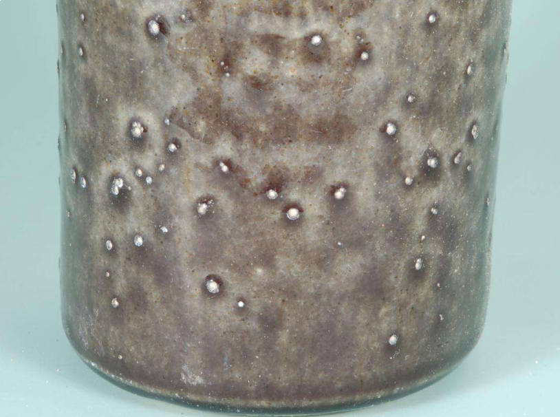
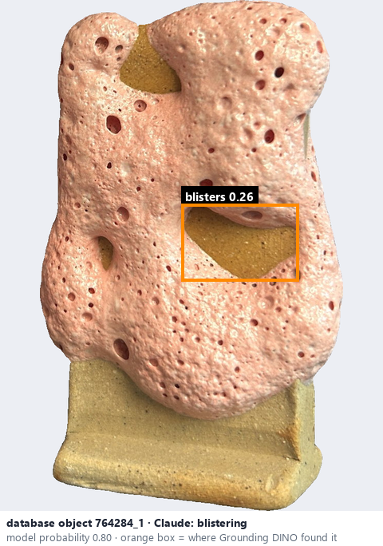
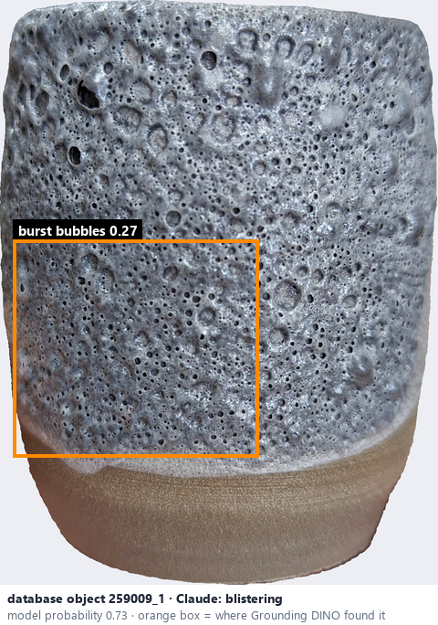

# Blistering · Phồng rộp

*possible defects* = **blistering**

## Identifying features
- Raised bubbles or burst blisters.
- Raised bubbles, blisters or ruptured bubble features.

**Recognition:** Raised or ruptured bubbles (relief), not flat marks.

*Source:* Ceramic Attribute Taxonomy (craze documentaries.pdf) p.8 · Glaze_Effects_Defects_Surface_Transparency_Reference_v2.pdf p.1

## Do not confuse with
- **pinholes** - Pinholes are tiny openings; blistering shows raised or ruptured bubbles. *(Ceramic_Real_Photo_Comparison_Guide_V4.pdf §4)*

## Images
  
Blistering - reference photo from your manual (Ceramic Attribute Taxonomy (craze documentaries.pdf) p.8)
  
database object 764284_1: Claude's label is blistering; model probability 0.80; box = Grounding DINO phrase 'blisters'
  
database object 259009_1: Claude's label is blistering; model probability 0.73; box = Grounding DINO phrase 'burst bubbles'
