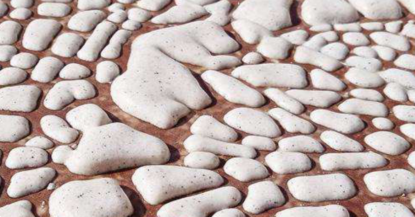
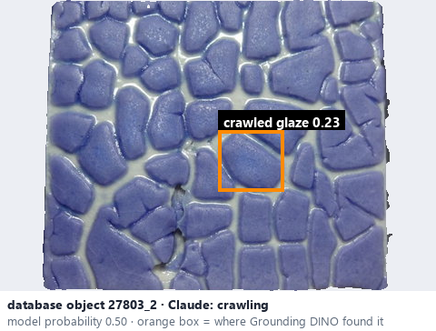
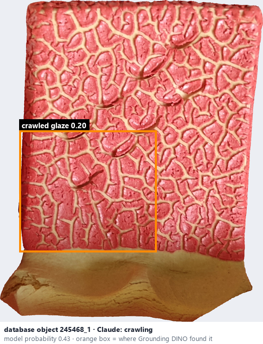

# Crawling · Co men

*possible defects* = **crawling**

## Identifying features
- Glaze separates into islands, exposing clay.
- Glaze retreats into islands leaving exposed clay; may be intentionally used.

**Recognition:** Bare clay between glaze islands; the photo cannot tell whether it was intended.

*Source:* Ceramic Attribute Taxonomy (craze documentaries.pdf) p.9 · Glaze_Effects_Defects_Surface_Transparency_Reference_v2.pdf p.1

## Do not confuse with
- **mottled** - Mottling is colour variation within the glaze, without bare clay. *(Ceramic_Real_Photo_Comparison_Guide_V4.pdf §5)*

## Images
  
Crawling - reference photo from your manual (Ceramic Attribute Taxonomy (craze documentaries.pdf) p.9)
  
database object 27803_2: Claude's label is crawling; model probability 0.50; box = Grounding DINO phrase 'crawled glaze'
  
database object 245468_1: Claude's label is crawling; model probability 0.43; box = Grounding DINO phrase 'crawled glaze'
