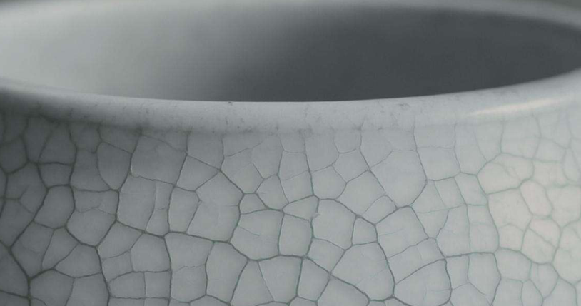
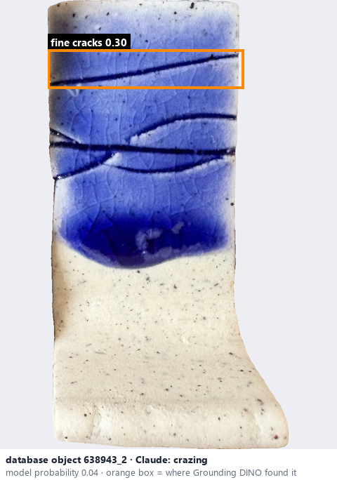
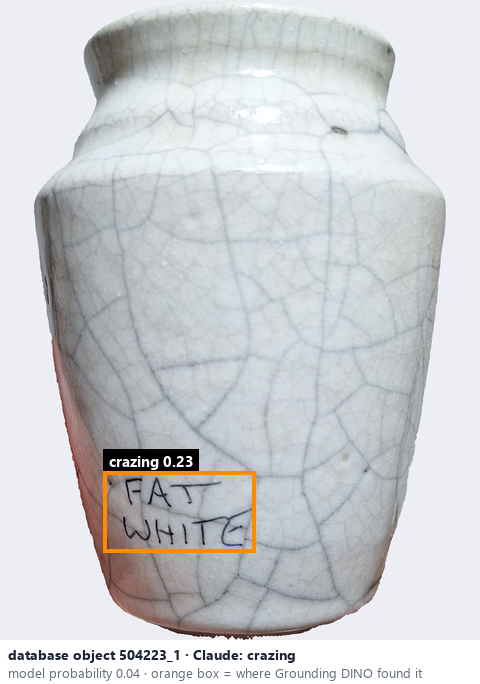

# Crazing · Nứt chân chim

*possible defects* = **crazing**

## Identifying features
- Fine interconnected cracks in the glaze.
- Fine crack network attributed to glaze-body mismatch; the image alone rarely confirms the cause.

**Recognition:** Record the visible crack network; do not claim a glaze-body mismatch without corroboration.

*Source:* Ceramic Attribute Taxonomy (craze documentaries.pdf) p.9 · Glaze_Effects_Defects_Surface_Transparency_Reference_v2.pdf p.1

## Do not confuse with
- **visible crack network (crackle)** - They can look almost identical; crackle is usually intended. *(Ceramic Attribute Taxonomy (craze documentaries.pdf) p.9 · Ceramic_Real_Photo_Comparison_Guide_V4.pdf §2)*

## Images
  
Crazing - reference photo from your manual (Ceramic Attribute Taxonomy (craze documentaries.pdf) p.9)
  
database object 638943_2: Claude's label is crazing; model probability 0.04; box = Grounding DINO phrase 'fine cracks'
  
database object 504223_1: Claude's label is crazing; model probability 0.04; box = Grounding DINO phrase 'crazing'
