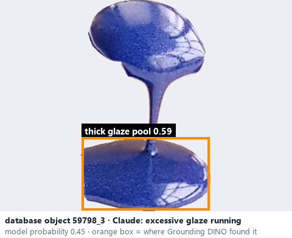
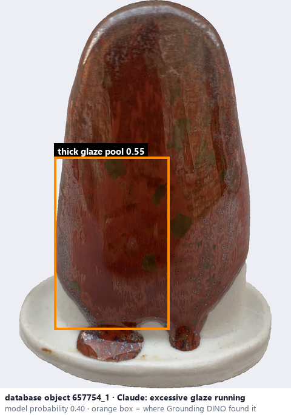

# Excessive glaze running

*possible defects* = **excessive glaze running**

## Identifying features
- Excessive glaze flow, potentially accumulating at the foot / base.
- Not every drip is a defect.

**Recognition:** Classify as a defect only with convincing excessive / undesired accumulation.

*Source:* Glaze_Effects_Defects_Surface_Transparency_Reference_v2.pdf p.2-3

## Do not confuse with
- **flowing** - Flow is an effect; running is a defect only with excessive accumulation. *(Glaze_Effects_Defects_Surface_Transparency_Reference_v2.pdf §3)*

## Images
  
database object 59798_3: Claude's label is excessive glaze running; model probability 0.45; box = Grounding DINO phrase 'thick glaze pool'
  
database object 657754_1: Claude's label is excessive glaze running; model probability 0.40; box = Grounding DINO phrase 'thick glaze pool'
