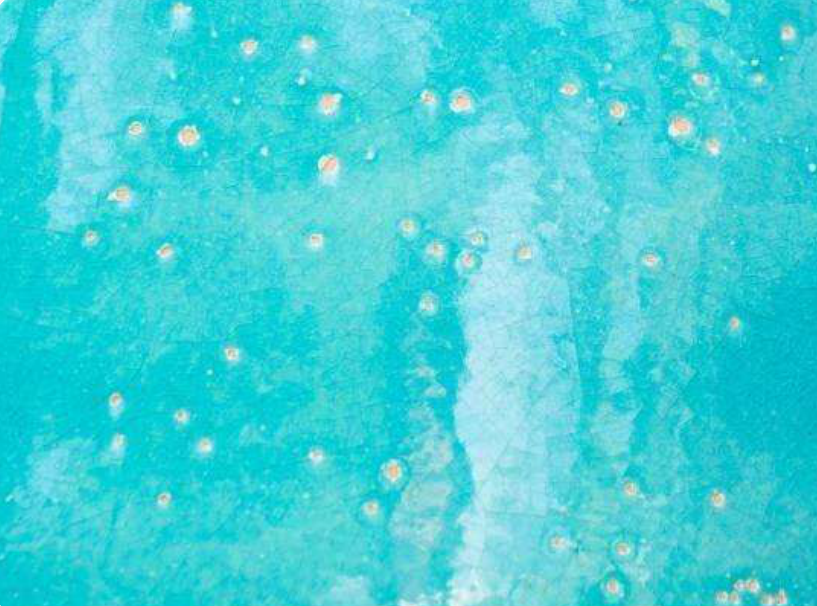
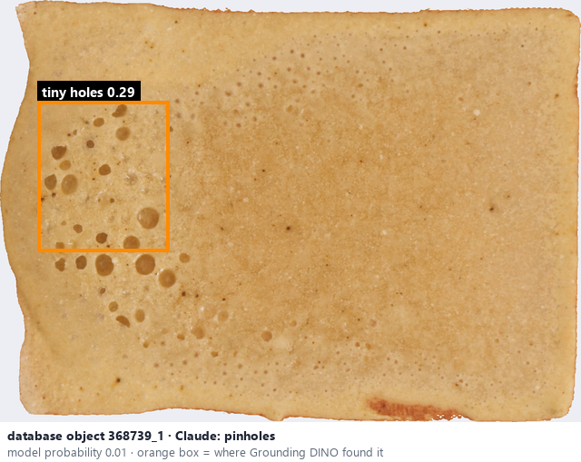

# Pinholes · Lỗ kim

*possible defects* = **pinholes**

## Identifying features
- Small holes penetrating the glaze layer.
- Tiny holes penetrating the glaze; differentiate from dark speckles.

**Recognition:** Require visible depth / relief before asserting a defect; otherwise Unknown.

*Source:* Ceramic Attribute Taxonomy (craze documentaries.pdf) p.8 · Glaze_Effects_Defects_Surface_Transparency_Reference_v2.pdf p.1

## Do not confuse with
- **speckled** - Speckles are coloured marks rather than holes. *(Ceramic_Real_Photo_Comparison_Guide_V4.pdf §4)*
- **dimpled** - Dimples are a repeated shallow texture. *(Ceramic_Real_Photo_Comparison_Guide_V4.pdf §9)*

## Images
  
Pinholes - reference photo from your manual (Ceramic Attribute Taxonomy (craze documentaries.pdf) p.8)
  
database object 368739_1: Claude's label is pinholes; model probability 0.01; box = Grounding DINO phrase 'tiny holes'
