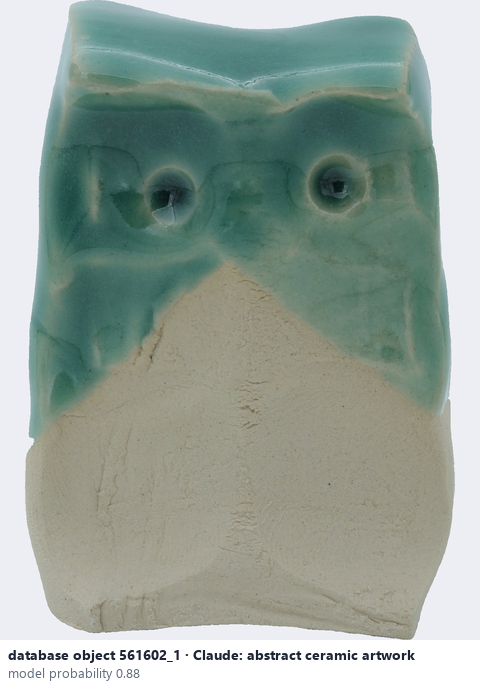
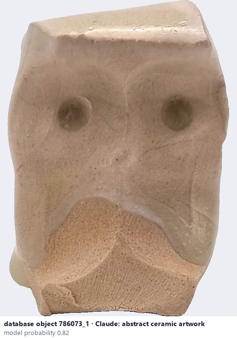

# Abstract ceramic artwork

*object form* = **abstract ceramic artwork**

## Identifying features
- Abstract art piece: no recognisable object or figure, form chosen for expression.

**Recognition:** Neither a vessel nor a figure.

*Source:* general description - not defined in your reference manuals

## Do not confuse with
- **irregular ceramic form** - Irregular forms are functional-looking but uneven or broken. *(general description - not defined in your reference manuals)*

## Images
  
database object 561602_1: Claude's label is abstract ceramic artwork; model probability 0.88
  
database object 786073_1: Claude's label is abstract ceramic artwork; model probability 0.82
