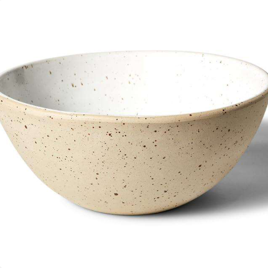
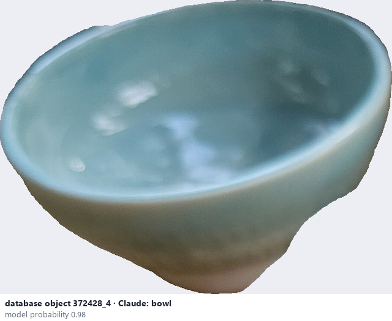
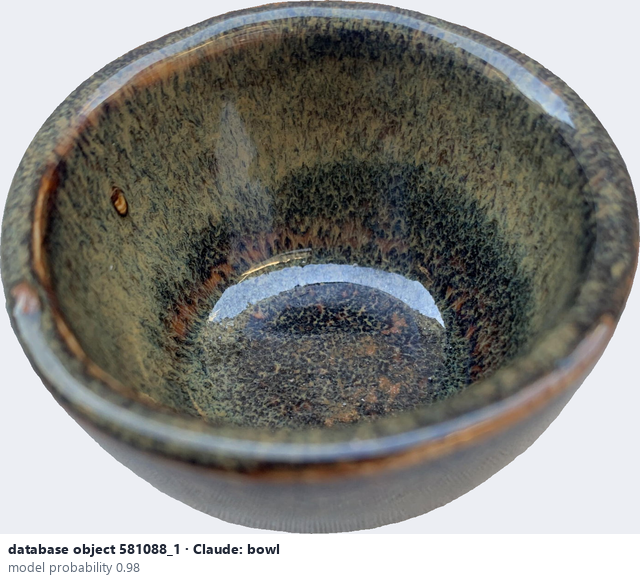

# Bowl

*object form* = **bowl**

## Identifying features
- Open, rounded vessel, usually wider than tall.
- The inside is visible from above; rim, curved wall, small foot.

**Recognition:** Look at the silhouette, opening and proportions.

*Source:* general description - not defined in your reference manuals (photo: Ceramic Attribute Taxonomy (craze documentaries.pdf) p.10)

## Do not confuse with
- **plate** - A plate is flat and shallow; a bowl has a deep curved wall. *(general description - not defined in your reference manuals)*
- **cup** - A cup is smaller and taller than wide, often with a handle. *(general description - not defined in your reference manuals)*

## Images
  
Bowl - reference photo from your manual (Ceramic Attribute Taxonomy (craze documentaries.pdf) p.10)
  
database object 372428_4: Claude's label is bowl; model probability 0.98
  
database object 581088_1: Claude's label is bowl; model probability 0.98
