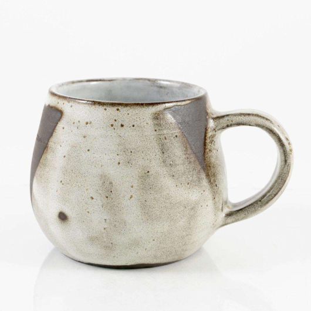
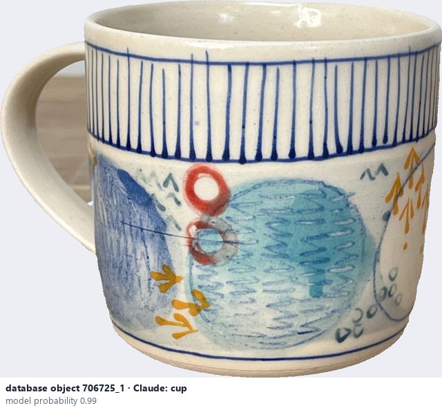
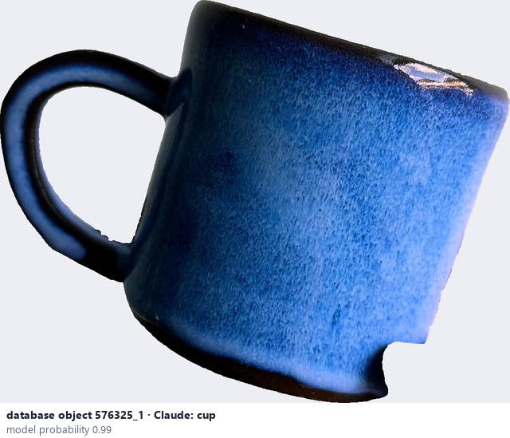

# Cup / mug

*object form* = **cup**

## Identifying features
- Small drinking vessel, about as tall as wide or taller.
- A mug has a handle.

**Recognition:** Look for the handle, the size and the upright wall.

*Source:* general description - not defined in your reference manuals (your manual lists 'Cup'; photo 'Mug': Ceramic Attribute Taxonomy (craze documentaries.pdf) p.10)

## Do not confuse with
- **bowl** - A bowl is wider than tall and has no handle. *(general description - not defined in your reference manuals)*

## Images
  
Cup / mug - reference photo from your manual (Ceramic Attribute Taxonomy (craze documentaries.pdf) p.10)
  
database object 706725_1: Claude's label is cup; model probability 0.99
  
database object 576325_1: Claude's label is cup; model probability 0.99
