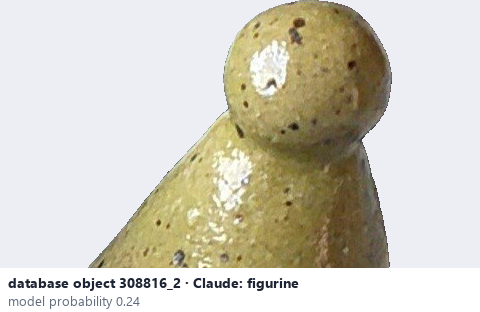

# Figurine

*object form* = **figurine**

## Identifying features
- Small figure of a person, an animal or a character.

**Recognition:** Recognisable figure, small scale.

*Source:* general description - not defined in your reference manuals

## Do not confuse with
- **sculpture** - A sculpture is a larger or abstract sculptural piece. *(general description - not defined in your reference manuals)*

## Images
  
database object 308816_2: Claude's label is figurine; model probability 0.24
