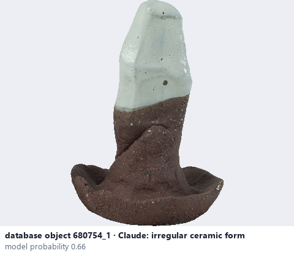
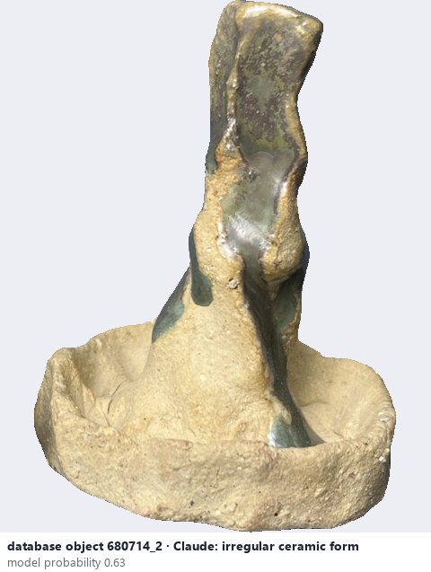

# Irregular ceramic form

*object form* = **irregular ceramic form**

## Identifying features
- Uneven, asymmetric or fragmentary piece that fits none of the regular forms (e.g. shards, pinched or slumped pieces).

**Recognition:** Use when no regular form fits.

*Source:* general description - not defined in your reference manuals

## Do not confuse with
- **abstract ceramic artwork** - An abstract artwork is a deliberate art piece. *(general description - not defined in your reference manuals)*

## Images
  
database object 680754_1: Claude's label is irregular ceramic form; model probability 0.66
  
database object 680714_2: Claude's label is irregular ceramic form; model probability 0.63
