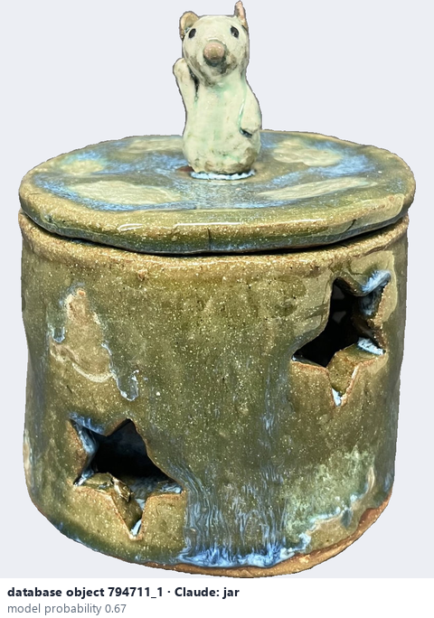
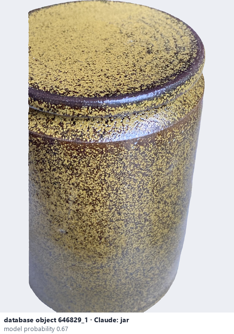

# Jar

*object form* = **jar**

## Identifying features
- Storage vessel with a wide mouth, often with a lid; body wider than the neck.

**Recognition:** Look for the wide opening and a lid or lid seat.

*Source:* general description - not defined in your reference manuals (your manual lists 'Jar' without a photo)

## Do not confuse with
- **vase** - A vase has a narrow neck. *(general description - not defined in your reference manuals)*

## Images
  
database object 794711_1: Claude's label is jar; model probability 0.67
  
database object 646829_1: Claude's label is jar; model probability 0.67
