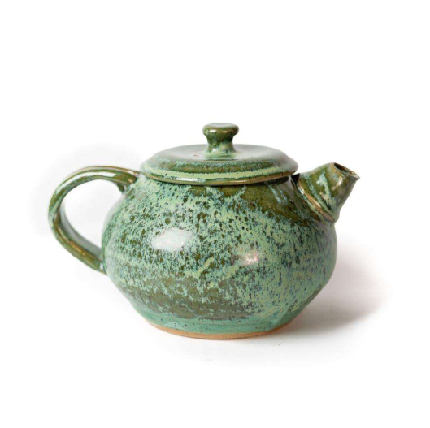
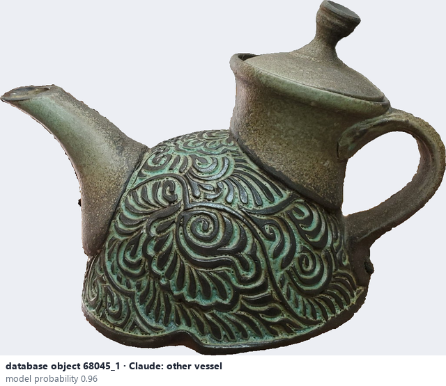
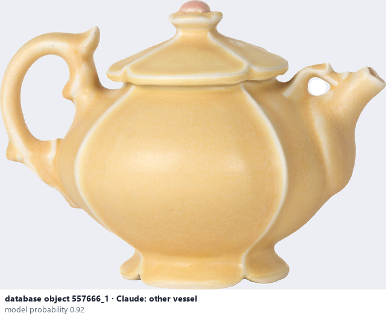

# Other vessel

*object form* = **other vessel**

## Identifying features
- Vessel that is not a bowl, cup, plate, vase or jar: teapot, pitcher, bottle, planter, dish …

**Recognition:** Has a vessel function (holds something) but another shape.

*Source:* general description - not defined in your reference manuals (your manual lists Pitcher, Planter, Bottle, Vessel; photo 'Teapot': Ceramic Attribute Taxonomy (craze documentaries.pdf) p.10)

## Images
  
Other vessel - reference photo from your manual (Ceramic Attribute Taxonomy (craze documentaries.pdf) p.10)
  
database object 68045_1: Claude's label is other vessel; model probability 0.96
  
database object 557666_1: Claude's label is other vessel; model probability 0.92
