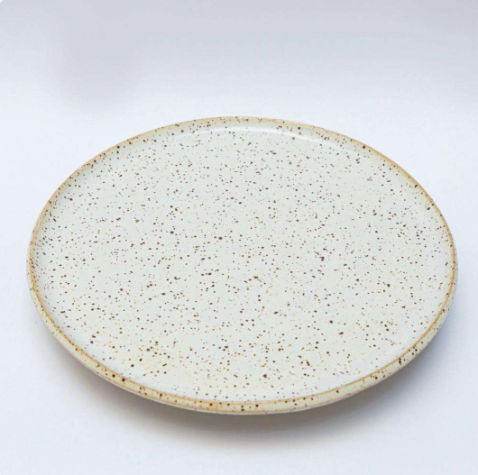
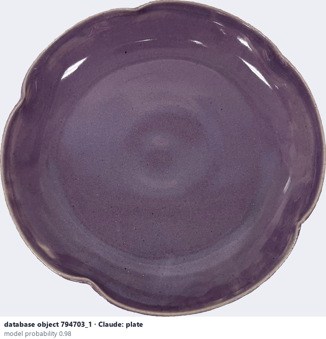
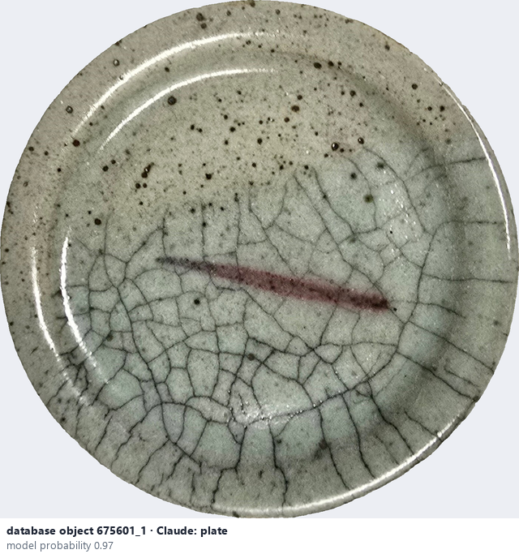

# Plate

*object form* = **plate**

## Identifying features
- Flat, wide and shallow, with a low rim.

**Recognition:** Look at the low profile and the wide flat centre.

*Source:* general description - not defined in your reference manuals (photo: Ceramic Attribute Taxonomy (craze documentaries.pdf) p.10)

## Do not confuse with
- **bowl** - A bowl is deeper, with a curved wall. *(general description - not defined in your reference manuals)*

## Images
  
Plate - reference photo from your manual (Ceramic Attribute Taxonomy (craze documentaries.pdf) p.10)
  
database object 794703_1: Claude's label is plate; model probability 0.98
  
database object 675601_1: Claude's label is plate; model probability 0.97
