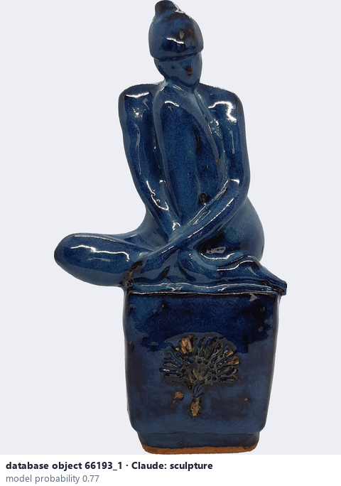
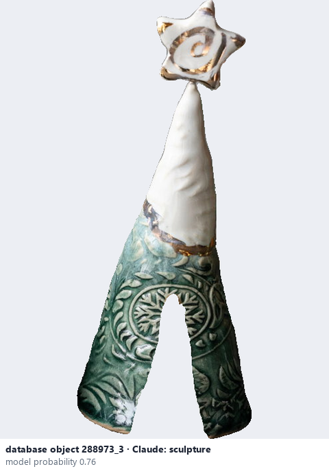

# Sculpture

*object form* = **sculpture**

## Identifying features
- Non-functional sculptural piece: no usable opening, the form is the work.

**Recognition:** No vessel function; built for its shape.

*Source:* general description - not defined in your reference manuals (your manual lists 'Sculpture' without a photo)

## Do not confuse with
- **figurine** - A figurine represents a person or an animal, usually small. *(general description - not defined in your reference manuals)*

## Images
  
database object 66193_1: Claude's label is sculpture; model probability 0.77
  
database object 288973_3: Claude's label is sculpture; model probability 0.76
