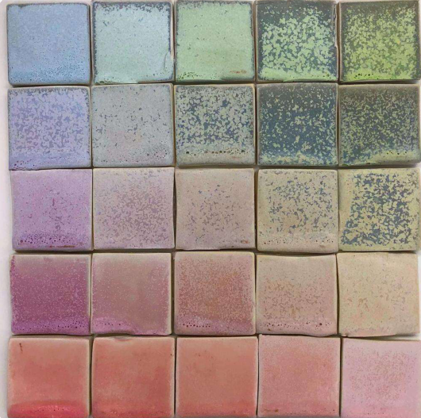
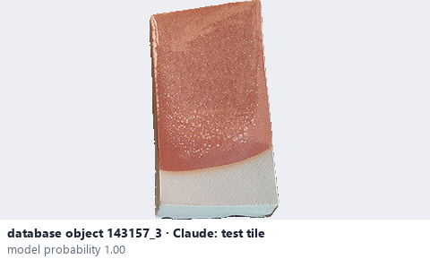
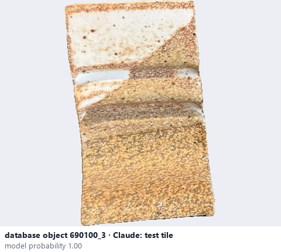

# Test tile

*object form* = **test tile**

## Identifying features
- Small flat slab made to test a glaze, often rectangular, sometimes with a fold or ridge so it stands upright.
- Often several on one board, sometimes with a hole or a label.

**Recognition:** Flat sample piece rather than a usable vessel.

*Source:* general description - not defined in your reference manuals (photo: Ceramic Attribute Taxonomy (craze documentaries.pdf) p.10)

## Images
  
Test tile - reference photo from your manual (Ceramic Attribute Taxonomy (craze documentaries.pdf) p.10)
  
database object 143157_3: Claude's label is test tile; model probability 1.00
  
database object 690100_3: Claude's label is test tile; model probability 1.00
