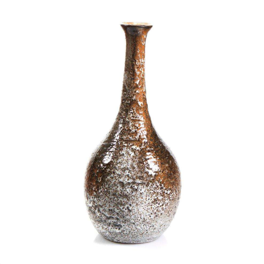
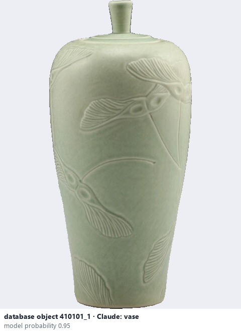
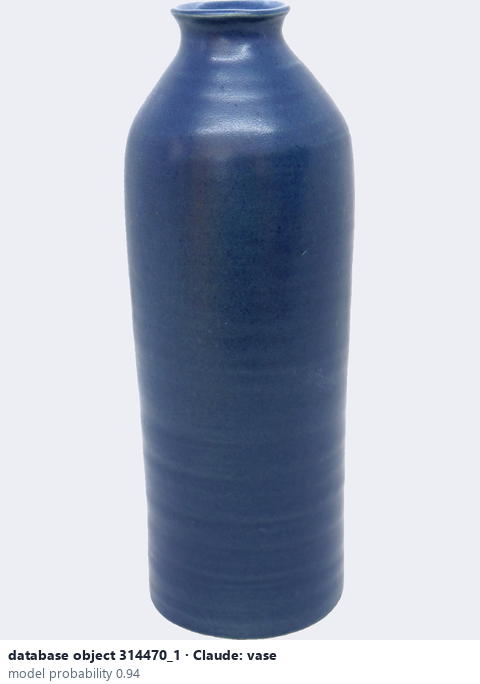

# Vase

*object form* = **vase**

## Identifying features
- Tall, mostly closed form with a narrower neck or opening.

**Recognition:** Look at the height and the narrow opening.

*Source:* general description - not defined in your reference manuals (photo: Ceramic Attribute Taxonomy (craze documentaries.pdf) p.10)

## Do not confuse with
- **jar** - A jar has a wide mouth and often a lid. *(general description - not defined in your reference manuals)*

## Images
  
Vase - reference photo from your manual (Ceramic Attribute Taxonomy (craze documentaries.pdf) p.10)
  
database object 410101_1: Claude's label is vase; model probability 0.95
  
database object 314470_1: Claude's label is vase; model probability 0.94
