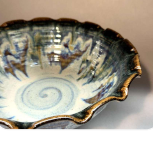
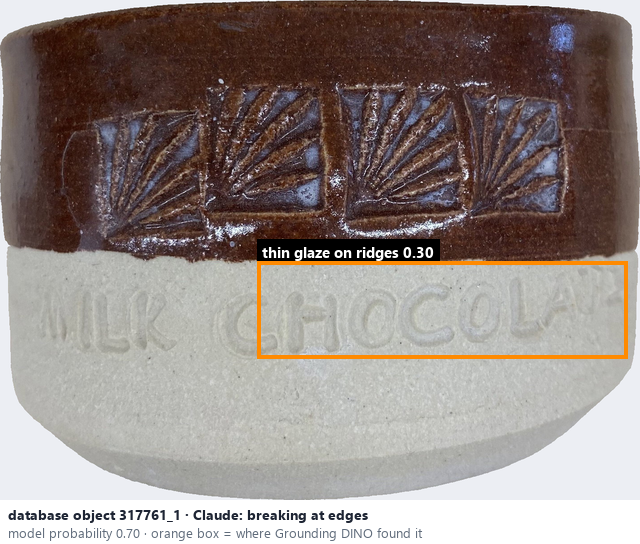
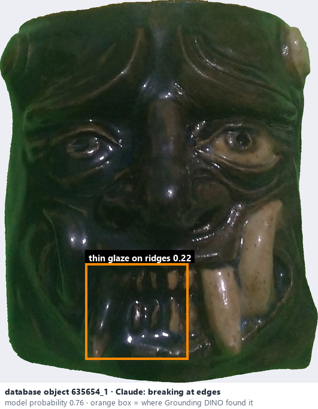

# Breaking at edges · Men đổi màu ở cạnh

*glaze effects* = **breaking at edges**

## Identifying features
- Colour changes at raised edges or ridges.
- Thinner glaze areas expose a different tone.

**Recognition:** Colour changes consistently follow the shape of the pottery.

*Source:* Ceramic Attribute Taxonomy (craze documentaries.pdf) p.7-8

## Do not confuse with
- **flowing** - Flowing follows gravity; breaking follows the ridges and edges of the form. *(Ceramic_Real_Photo_Comparison_Guide_V4.pdf §3)*

## Images
  
Breaking at edges - reference photo from your manual (Ceramic Attribute Taxonomy (craze documentaries.pdf) p.8)
  
database object 317761_1: Claude's label is breaking at edges; model probability 0.70; box = Grounding DINO phrase 'thin glaze on ridges'
  
database object 635654_1: Claude's label is breaking at edges; model probability 0.76; box = Grounding DINO phrase 'thin glaze on ridges'
