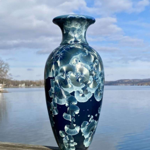
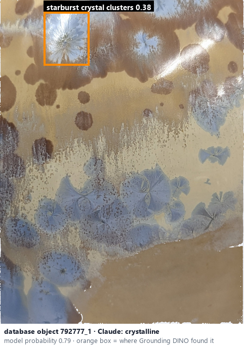
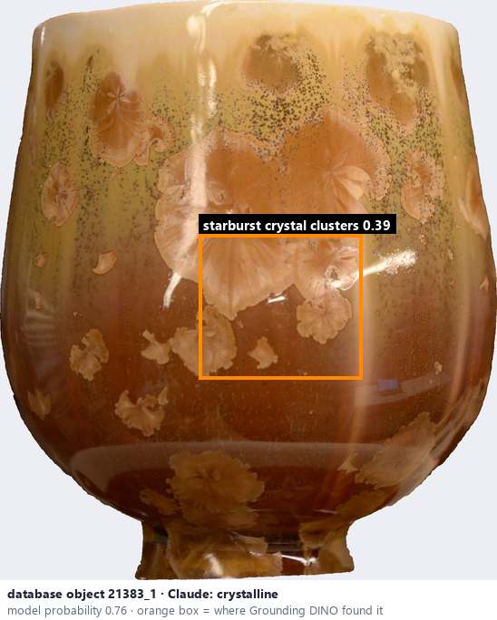

# Crystalline · Men kết tinh

*glaze effects* = **crystalline**

## Identifying features
- Flower-like or starburst crystalline structures.
- Radiating, branching shapes.
- Crystals contrast with surrounding glaze.

**Recognition:** Distinct crystal clusters with radial patterns.

*Source:* Ceramic Attribute Taxonomy (craze documentaries.pdf) p.6

## Do not confuse with
- **speckled** - Speckled: small dispersed spots; crystalline: branching or flower / starburst clusters. Use the structure, not colour alone. *(Ceramic_Real_Photo_Comparison_Guide_V4.pdf §1)*

## Images
  
Crystalline - reference photo from your manual (Ceramic Attribute Taxonomy (craze documentaries.pdf) p.6)
  
database object 792777_1: Claude's label is crystalline; model probability 0.79; box = Grounding DINO phrase 'starburst crystal clusters'
  
database object 21383_1: Claude's label is crystalline; model probability 0.76; box = Grounding DINO phrase 'starburst crystal clusters'
