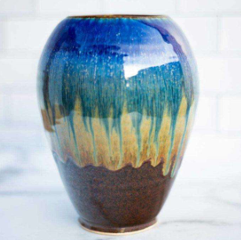
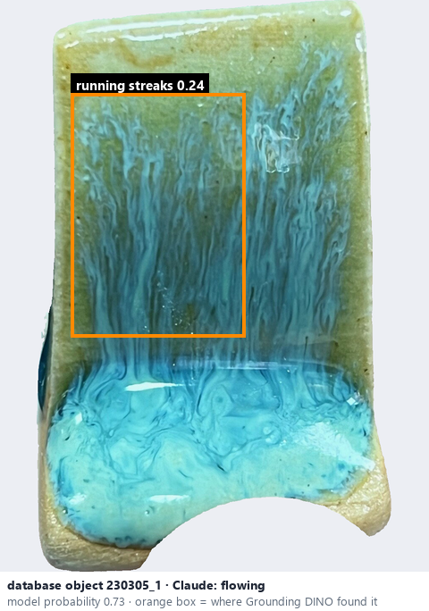
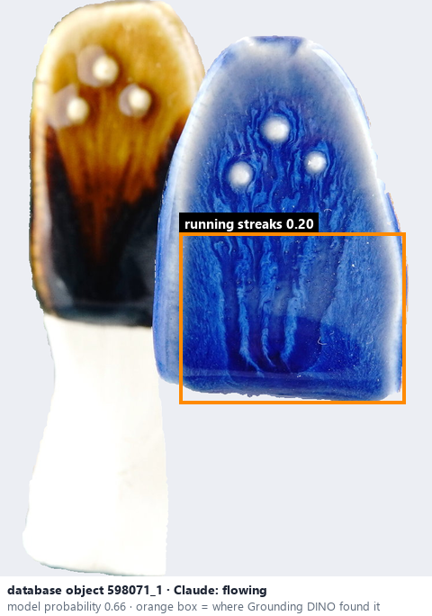

# Dripping / flowing · Men chảy

*glaze effects* = **flowing**

## Identifying features
- Downward streaks or rivulets.
- Colour pooling near lower edges.
- Uneven glaze thickness.

**Recognition:** Gravity-aligned flowing patterns, often extending vertically.

*Source:* Ceramic Attribute Taxonomy (craze documentaries.pdf) p.7

## Do not confuse with
- **breaking at edges** - Flowing is gravity-aligned streaking; breaking is thinning / colour change over raised ridges. *(Ceramic_Real_Photo_Comparison_Guide_V4.pdf §3)*
- **excessive glaze running** - Not every drip is a defect: call it running only with clear excessive accumulation. *(Glaze_Effects_Defects_Surface_Transparency_Reference_v2.pdf §3)*

## Images
  
Dripping / flowing - reference photo from your manual (Ceramic Attribute Taxonomy (craze documentaries.pdf) p.7)
  
database object 230305_1: Claude's label is flowing; model probability 0.73; box = Grounding DINO phrase 'running streaks'
  
database object 598071_1: Claude's label is flowing; model probability 0.66; box = Grounding DINO phrase 'running streaks'
