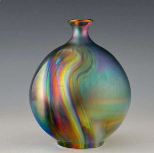
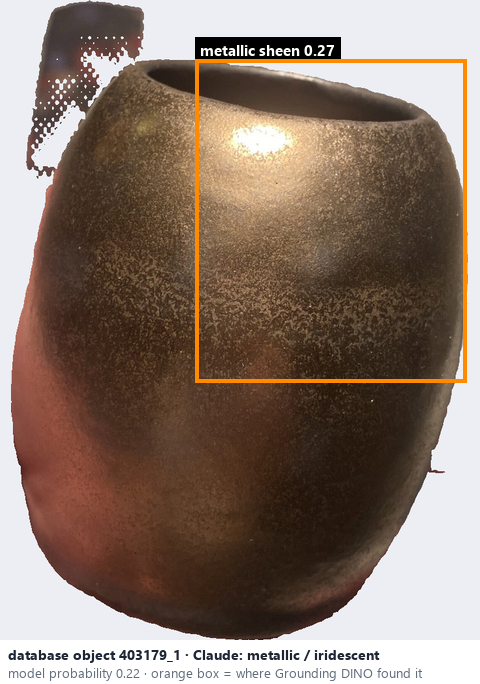
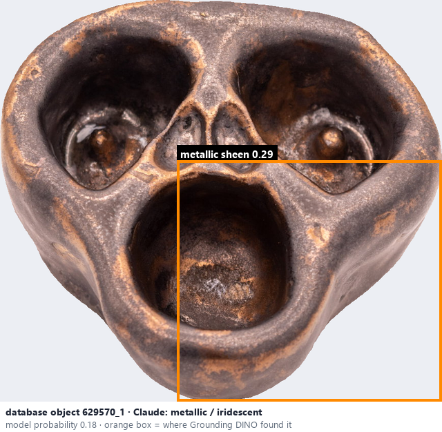

# Metallic / iridescent · Men ánh kim

*glaze effects* = **metallic / iridescent**

## Identifying features
- Metal-like reflections.
- Gold, silver, copper, or rainbow-like highlights.
- Strong viewing-angle dependence.

**Recognition:** Reflective colour shifts and metal-like sheen.

*Source:* Ceramic Attribute Taxonomy (craze documentaries.pdf) p.8

## Do not confuse with
- **glossy** - Single-photo lighting can imitate metallic effects; ordinary gloss is a strong reflection without metallic colour. *(Ceramic_Real_Photo_Comparison_Guide_V4.pdf §10)*

## Images
  
Metallic / iridescent - reference photo from your manual (Ceramic Attribute Taxonomy (craze documentaries.pdf) p.8)
  
database object 403179_1: Claude's label is metallic / iridescent; model probability 0.22; box = Grounding DINO phrase 'metallic sheen'
  
database object 629570_1: Claude's label is metallic / iridescent; model probability 0.18; box = Grounding DINO phrase 'metallic sheen'
