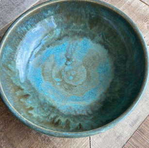
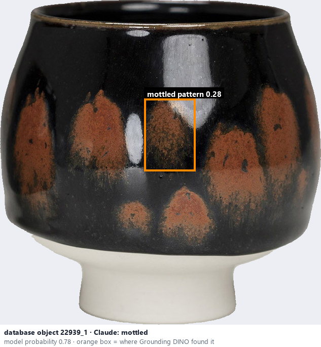
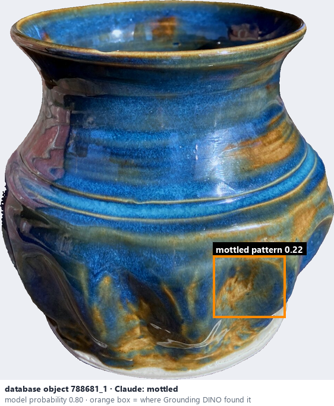

# Mottled / variegated · Men loang màu

*glaze effects* = **mottled**

## Identifying features
- Irregular patches of different colours.
- Cloud-like transitions.
- Uneven colour distribution.

**Recognition:** Blended patches without clearly defined geometric boundaries.

*Source:* Ceramic Attribute Taxonomy (craze documentaries.pdf) p.7

## Do not confuse with
- **crawling** - Crawling reveals bare clay between separated glaze islands; mottling is colour variation within the glaze. *(Ceramic_Real_Photo_Comparison_Guide_V4.pdf §5)*

## Images
  
Mottled / variegated - reference photo from your manual (Ceramic Attribute Taxonomy (craze documentaries.pdf) p.7)
  
database object 22939_1: Claude's label is mottled; model probability 0.78; box = Grounding DINO phrase 'mottled pattern'
  
database object 788681_1: Claude's label is mottled; model probability 0.80; box = Grounding DINO phrase 'mottled pattern'
