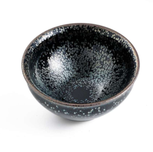
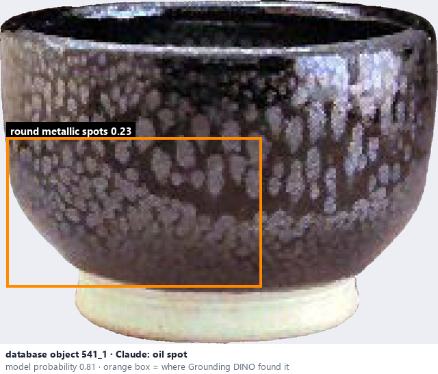
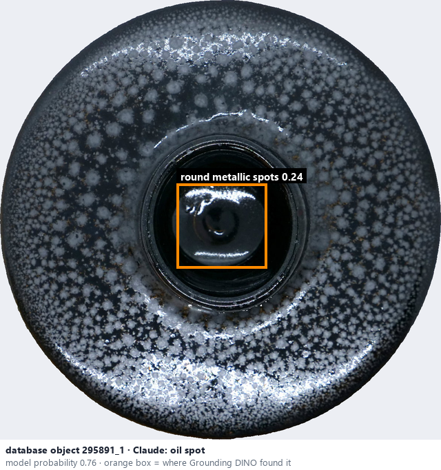

# Oil spot · Men đốm dầu

*glaze effects* = **oil spot**

## Identifying features
- Numerous round or oval metallic-looking spots.
- Often a dark background.
- Spots vary in size.

**Recognition:** Repeated circular dots resembling oil droplets.

*Source:* Ceramic Attribute Taxonomy (craze documentaries.pdf) p.7

## Do not confuse with
- **speckled** - Speckled: small dispersed spots; oil spot: larger rounded, often metallic-looking spots. *(Ceramic_Real_Photo_Comparison_Guide_V4.pdf §1)*

## Images
  
Oil spot - reference photo from your manual (Ceramic Attribute Taxonomy (craze documentaries.pdf) p.7)
  
database object 541_1: Claude's label is oil spot; model probability 0.81; box = Grounding DINO phrase 'round metallic spots'
  
database object 295891_1: Claude's label is oil spot; model probability 0.76; box = Grounding DINO phrase 'round metallic spots'
