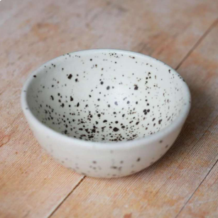
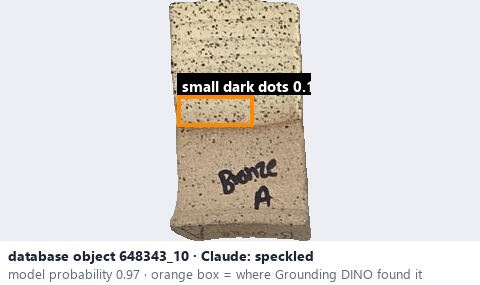
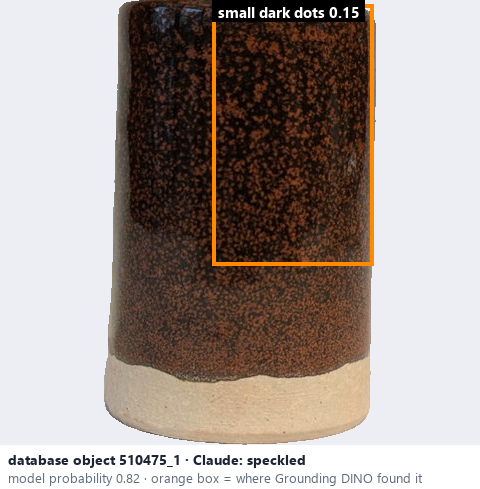

# Speckled · Men chấm li ti

*glaze effects* = **speckled**

## Identifying features
- Tiny contrasting dots distributed across the glaze.
- Random or approximately uniform distribution.

**Recognition:** Small dark or coloured spots that do not necessarily form a regular pattern.

*Source:* Ceramic Attribute Taxonomy (craze documentaries.pdf) p.7

## Do not confuse with
- **oil spot** - Oil spot: larger rounded, often metallic spots. *(Ceramic_Real_Photo_Comparison_Guide_V4.pdf §1)*
- **pinholes** - Speckles are coloured marks, not holes; pinholes are tiny openings. *(Ceramic_Real_Photo_Comparison_Guide_V4.pdf §4)*

## Images
  
Speckled - reference photo from your manual (Ceramic Attribute Taxonomy (craze documentaries.pdf) p.7)
  
database object 648343_10: Claude's label is speckled; model probability 0.97; box = Grounding DINO phrase 'small dark dots'
  
database object 510475_1: Claude's label is speckled; model probability 0.82; box = Grounding DINO phrase 'small dark dots'
