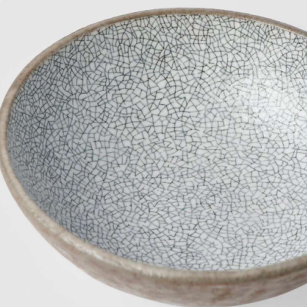
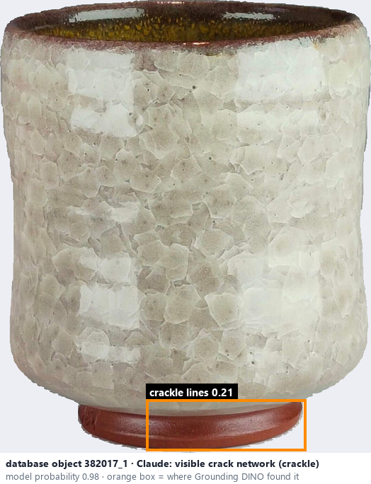
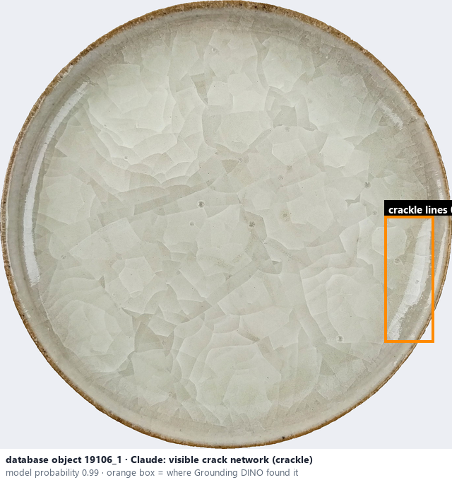

# Crackle · Men rạn

*glaze effects* = **visible crack network (crackle)**

## Identifying features
- Fine interconnected lines.
- Polygon-like networks.
- Lines may be darkened for decorative effect.

**Recognition:** A connected web of fine cracks, distinct from random speckles.

*Source:* Ceramic Attribute Taxonomy (craze documentaries.pdf) p.7

## Do not confuse with
- **crazing** - Crackle and crazing can look almost identical in photos: crackle is usually intended, crazing is cracking from a glaze-body mismatch. Record the visible network; the photo cannot establish intent. *(Ceramic Attribute Taxonomy (craze documentaries.pdf) p.9 · Ceramic_Real_Photo_Comparison_Guide_V4.pdf §2)*

## Images
  
Crackle - reference photo from your manual (Ceramic Attribute Taxonomy (craze documentaries.pdf) p.7)
  
database object 382017_1: Claude's label is visible crack network (crackle); model probability 0.98; box = Grounding DINO phrase 'crackle lines'
  
database object 19106_1: Claude's label is visible crack network (crackle); model probability 0.99; box = Grounding DINO phrase 'crackle lines'
