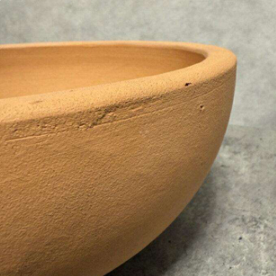
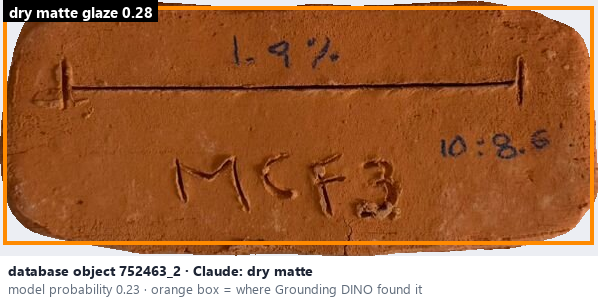
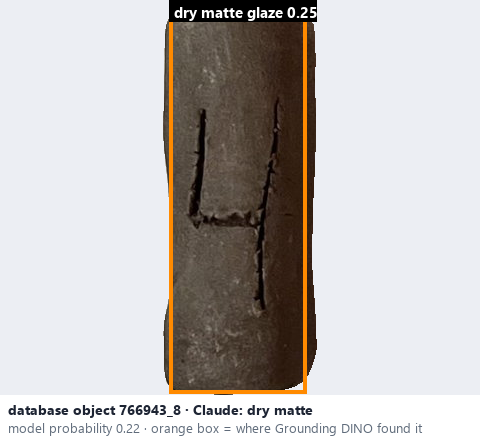

# Dry matte · Mờ khô, phấn

*surface finish* = **dry matte**

## Identifying features
- Almost no visible sheen.
- Chalky or powdery-looking finish.
- Can resemble unglazed clay.

**Recognition:** Extremely low reflection and a dry-looking surface.

*Source:* Ceramic Attribute Taxonomy (craze documentaries.pdf) p.3

## Do not confuse with
- **matte** - Matte may keep a faint even sheen; dry matte looks chalky, almost like bare clay. *(Ceramic Attribute Taxonomy (craze documentaries.pdf) p.2-3)*

## Images
  
Dry matte - reference photo from your manual (Ceramic Attribute Taxonomy (craze documentaries.pdf) p.3)
  
database object 752463_2: Claude's label is dry matte; model probability 0.23; box = Grounding DINO phrase 'dry matte glaze'
  
database object 766943_8: Claude's label is dry matte; model probability 0.22; box = Grounding DINO phrase 'dry matte glaze'
