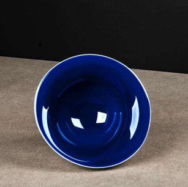
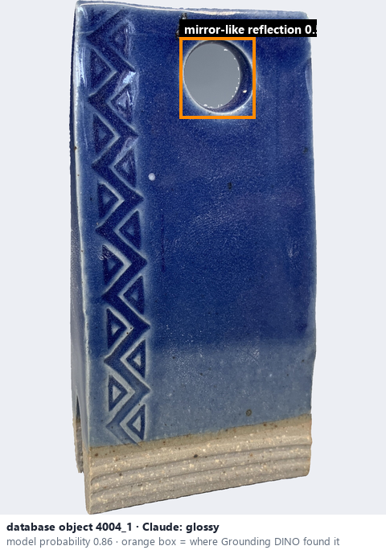
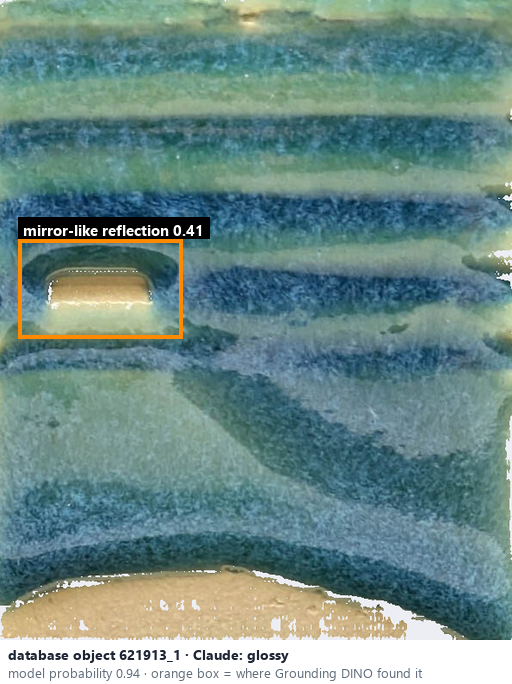

# Glossy · Bóng cao

*surface finish* = **glossy**

## Identifying features
- Strong, sharp white highlights.
- Reflections can resemble glass.
- Smooth-looking, reflective surface.

**Recognition:** Look for bright, concentrated reflections of the light source.

*Source:* Ceramic Attribute Taxonomy (craze documentaries.pdf) p.2

## Do not confuse with
- **semi-glossy** - Glossy: sharp bright reflections; semi-glossy: softer highlights; satin: broad gentle sheen. Lighting and viewing angle are confounders. *(Ceramic_Real_Photo_Comparison_Guide_V4.pdf §6)*
- **metallic / iridescent** - Metallic has a metal-like or angle-dependent coloured sheen; ordinary gloss is strong specular reflection without a metallic glaze. *(Ceramic_Real_Photo_Comparison_Guide_V4.pdf §10)*

## Images
  
Glossy - reference photo from your manual (Ceramic Attribute Taxonomy (craze documentaries.pdf) p.2)
  
database object 4004_1: Claude's label is glossy; model probability 0.86; box = Grounding DINO phrase 'mirror-like reflection'
  
database object 621913_1: Claude's label is glossy; model probability 0.94; box = Grounding DINO phrase 'mirror-like reflection'
