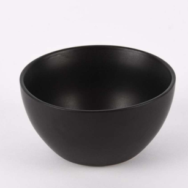
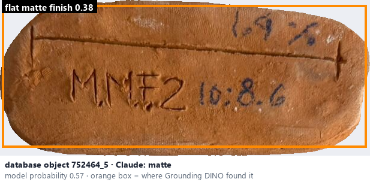
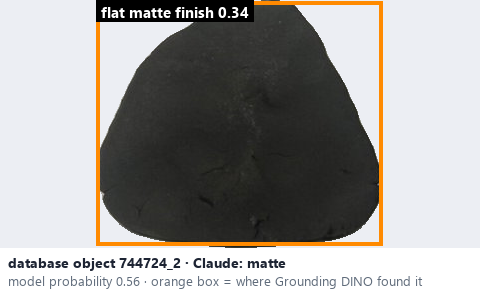

# Matte · Mờ, không bóng

*surface finish* = **matte**

## Identifying features
- Little or no sharp reflection.
- Diffuse light scattering.
- Usually an even, non-glossy appearance.

**Recognition:** Light spreads across the surface instead of forming sharp highlights.

*Source:* Ceramic Attribute Taxonomy (craze documentaries.pdf) p.2

## Do not confuse with
- **smooth matte** - Smooth matte looks even and low-gloss; ordinary matte means low reflectivity without implying roughness. *(Ceramic_Real_Photo_Comparison_Guide_V4.pdf §7)*
- **stony matte** - Stony matte appears granular / mineral. Do not equate matte with rough: texture is a separate attribute. *(Ceramic_Real_Photo_Comparison_Guide_V4.pdf §7)*

## Images
  
Matte - reference photo from your manual (Ceramic Attribute Taxonomy (craze documentaries.pdf) p.2)
  
database object 752464_5: Claude's label is matte; model probability 0.57; box = Grounding DINO phrase 'flat matte finish'
  
database object 744724_2: Claude's label is matte; model probability 0.56; box = Grounding DINO phrase 'flat matte finish'
