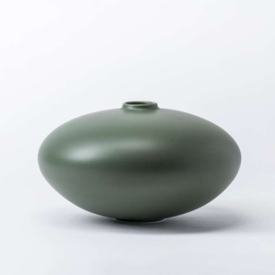
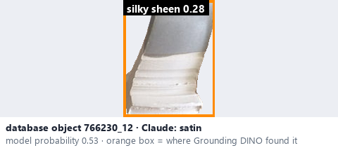
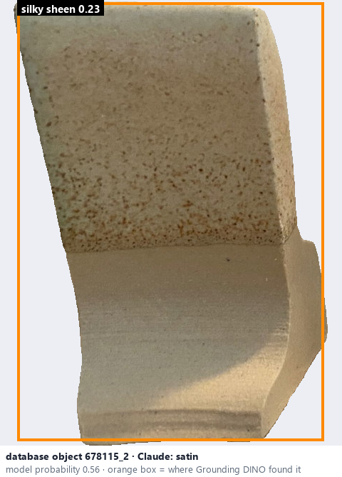

# Satin · Bóng mờ như lụa

*surface finish* = **satin**

## Identifying features
- Soft, silky sheen.
- Broad, gentle light reflections.
- Visually between matte and glossy.

**Recognition:** Soft luminous highlights, without a mirror-like reflection.

*Source:* Ceramic Attribute Taxonomy (craze documentaries.pdf) p.2

## Do not confuse with
- **semi-glossy** - Semi-glossy still shows visible (softer) highlights; satin only a broad gentle sheen. *(Ceramic_Real_Photo_Comparison_Guide_V4.pdf §6)*
- **satin-matte** - Satin, semi-matte and satin-matte overlap considerably; one photo may not separate them. *(Ceramic Attribute Taxonomy (craze documentaries.pdf) p.3)*

## Images
  
Satin - reference photo from your manual (Ceramic Attribute Taxonomy (craze documentaries.pdf) p.2)
  
database object 766230_12: Claude's label is satin; model probability 0.53; box = Grounding DINO phrase 'silky sheen'
  
database object 678115_2: Claude's label is satin; model probability 0.56; box = Grounding DINO phrase 'silky sheen'
