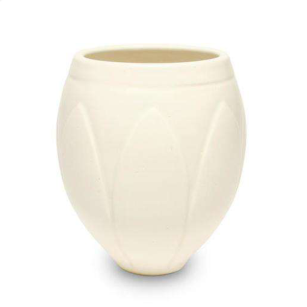
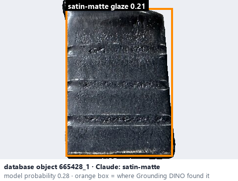
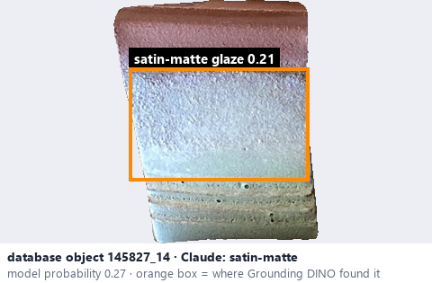

# Satin-matte · Mờ mịn với ánh lụa

*surface finish* = **satin-matte**

## Identifying features
- Soft, muted sheen.
- Low reflectivity.
- Fine, uniform-looking finish.

**Recognition:** Matte-dominant appearance with a delicate satin glow.

*Source:* Ceramic Attribute Taxonomy (craze documentaries.pdf) p.3

## Do not confuse with
- **satin** - Satin, semi-matte and satin-matte overlap considerably; one photo may not separate them. *(Ceramic Attribute Taxonomy (craze documentaries.pdf) p.3)*
- **semi-matte** - Same overlap; judge the strength of the sheen, and abstain when unsure. *(Ceramic Attribute Taxonomy (craze documentaries.pdf) p.3)*

## Images
  
Satin-matte - reference photo from your manual (Ceramic Attribute Taxonomy (craze documentaries.pdf) p.3)
  
database object 665428_1: Claude's label is satin-matte; model probability 0.28; box = Grounding DINO phrase 'satin-matte glaze'
  
database object 145827_14: Claude's label is satin-matte; model probability 0.27; box = Grounding DINO phrase 'satin-matte glaze'
