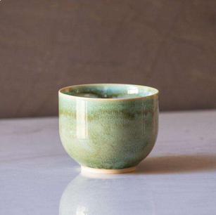
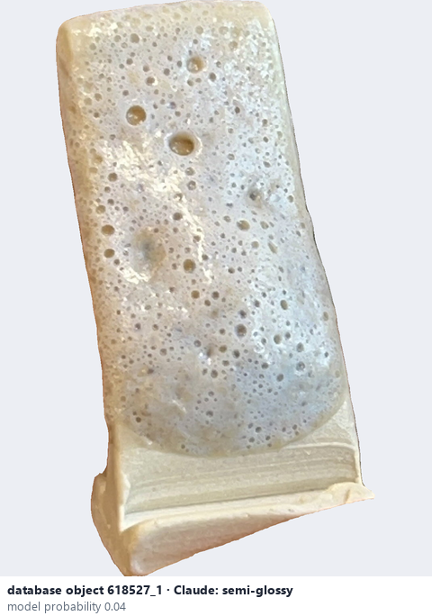
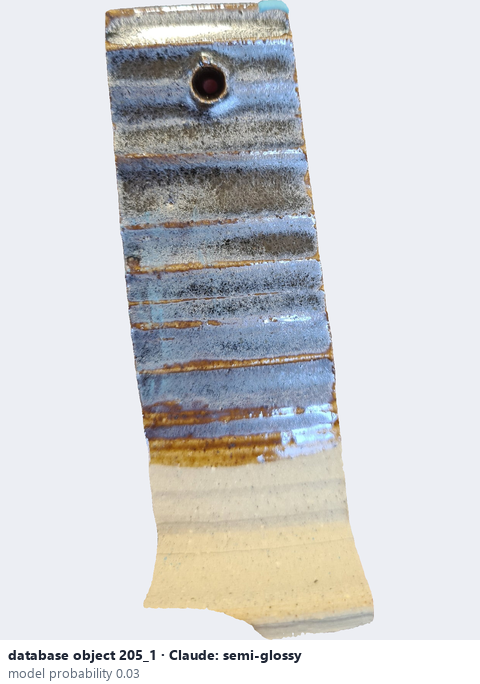

# Semi-glossy · Bóng vừa

*surface finish* = **semi-glossy**

## Identifying features
- Visible but softer highlights.
- Less mirror-like than glossy.
- Light reflections have less defined edges.

**Recognition:** Moderate shine without a strong mirror effect.

*Source:* Ceramic Attribute Taxonomy (craze documentaries.pdf) p.2

## Do not confuse with
- **glossy** - Glossy: sharp bright reflections; semi-glossy: softer highlights. *(Ceramic_Real_Photo_Comparison_Guide_V4.pdf §6)*
- **satin** - Satin: broad gentle sheen, no mirror-like reflection. *(Ceramic_Real_Photo_Comparison_Guide_V4.pdf §6)*

## Images
  
Semi-glossy - reference photo from your manual (Ceramic Attribute Taxonomy (craze documentaries.pdf) p.2)
  
database object 618527_1: Claude's label is semi-glossy; model probability 0.04; no box: the model does not propose this value in its top 3
  
database object 205_1: Claude's label is semi-glossy; model probability 0.03; no box: the model does not propose this value in its top 3
