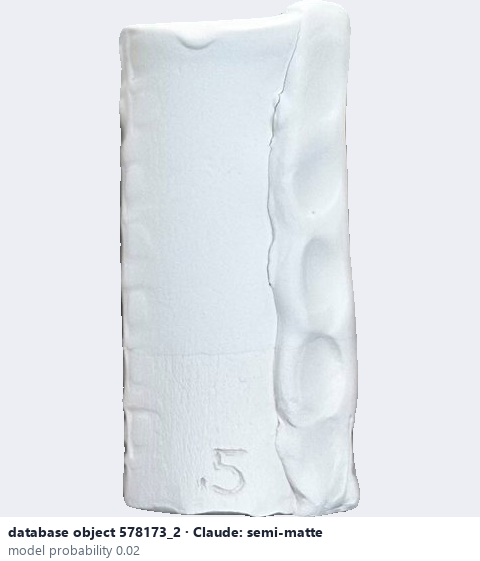
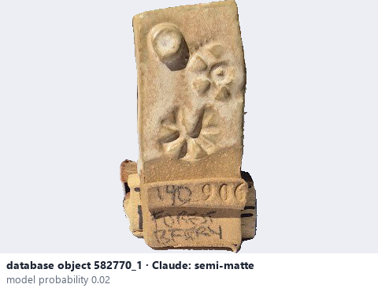

# Semi-matte · Gần mờ, hơi bóng

*surface finish* = **semi-matte**

## Identifying features
- Mostly non-reflective.
- Small amounts of diffuse sheen.
- Can resemble satin under certain lighting.

**Recognition:** Mostly matte appearance, with weak reflections at some viewing angles.

*Source:* Ceramic Attribute Taxonomy (craze documentaries.pdf) p.2-3

## Do not confuse with
- **satin-matte** - Satin, semi-matte and satin-matte overlap considerably; one photo may not separate them. *(Ceramic Attribute Taxonomy (craze documentaries.pdf) p.3)*
- **matte** - Matte: little or no sharp reflection at any angle. *(Ceramic Attribute Taxonomy (craze documentaries.pdf) p.2)*

## Images
  
database object 578173_2: Claude's label is semi-matte; model probability 0.02; no box: the model does not propose this value in its top 3
  
database object 582770_1: Claude's label is semi-matte; model probability 0.02; no box: the model does not propose this value in its top 3
