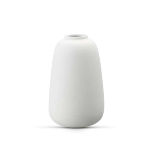
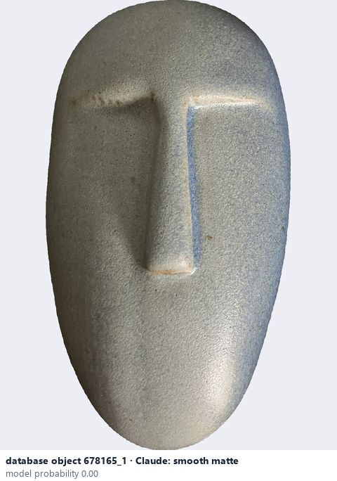
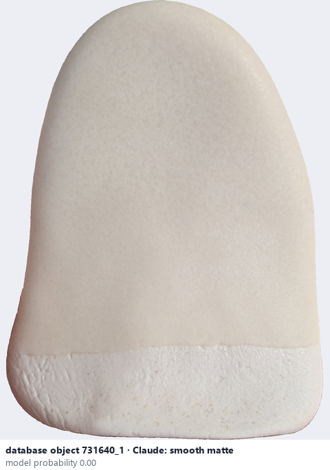

# Smooth matte · Mờ và mịn

*surface finish* = **smooth matte**

## Identifying features
- Very low gloss.
- Smooth-looking, uniform surface.
- No obvious coarse grains or bumps.

**Recognition:** Matte reflection combined with visually smooth texture.

*Source:* Ceramic Attribute Taxonomy (craze documentaries.pdf) p.3

## Do not confuse with
- **stony matte** - Smooth matte looks even; stony matte appears granular / mineral. *(Ceramic_Real_Photo_Comparison_Guide_V4.pdf §7)*

## Images
  
Smooth matte - reference photo from your manual (Ceramic Attribute Taxonomy (craze documentaries.pdf) p.3)
  
database object 678165_1: Claude's label is smooth matte; model probability 0.00; no box: the model does not propose this value in its top 3
  
database object 731640_1: Claude's label is smooth matte; model probability 0.00; no box: the model does not propose this value in its top 3
