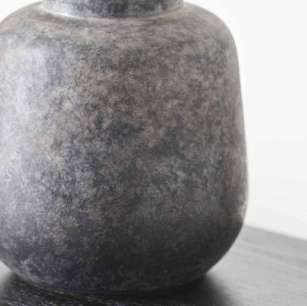
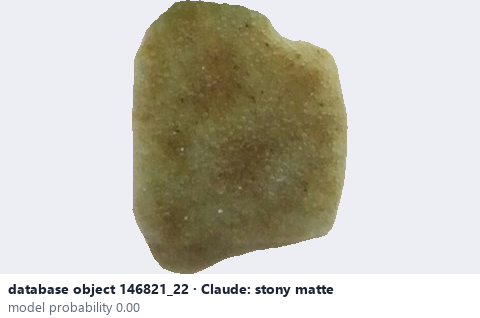
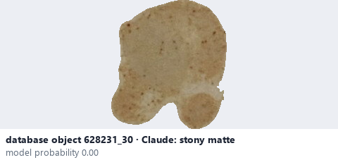

# Stony matte · Mờ giống đá

*surface finish* = **stony matte**

## Identifying features
- Stone-like visual appearance.
- May have granular or mineral-looking texture.
- Irregular light scattering.

**Recognition:** Resembles natural stone rather than smooth glass.

*Source:* Ceramic Attribute Taxonomy (craze documentaries.pdf) p.3

## Do not confuse with
- **smooth matte** - Smooth matte looks even and low-gloss; stony matte appears granular / mineral. *(Ceramic_Real_Photo_Comparison_Guide_V4.pdf §7)*

## Images
  
Stony matte - reference photo from your manual (Ceramic Attribute Taxonomy (craze documentaries.pdf) p.3)
  
database object 146821_22: Claude's label is stony matte; model probability 0.00; no box: the model does not propose this value in its top 3
  
database object 628231_30: Claude's label is stony matte; model probability 0.00; no box: the model does not propose this value in its top 3
