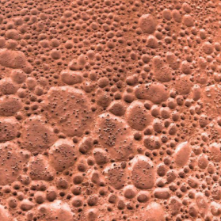
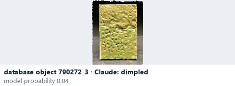
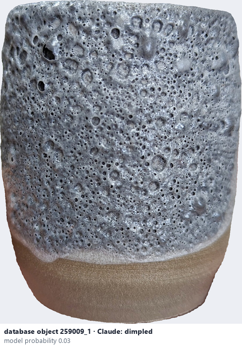

# Dimpled / orange peel · Lõm li ti

*surface texture* = **dimpled**

## Identifying features
- Small shallow depressions across the glaze.

**Recognition:** Repeated tiny dimples resembling orange skin.

*Source:* Ceramic Attribute Taxonomy (craze documentaries.pdf) p.5

## Do not confuse with
- **pinholes** - Dimpled texture is a repeated surface pattern; pinholes are small openings through the glaze. A photo may not reveal true depth. *(Ceramic_Real_Photo_Comparison_Guide_V4.pdf §9)*

## Images
  
Dimpled / orange peel - reference photo from your manual (Ceramic Attribute Taxonomy (craze documentaries.pdf) p.5)
  
database object 790272_3: Claude's label is dimpled; model probability 0.04; no box: the model does not propose this value in its top 3
  
database object 259009_1: Claude's label is dimpled; model probability 0.03; no box: the model does not propose this value in its top 3
