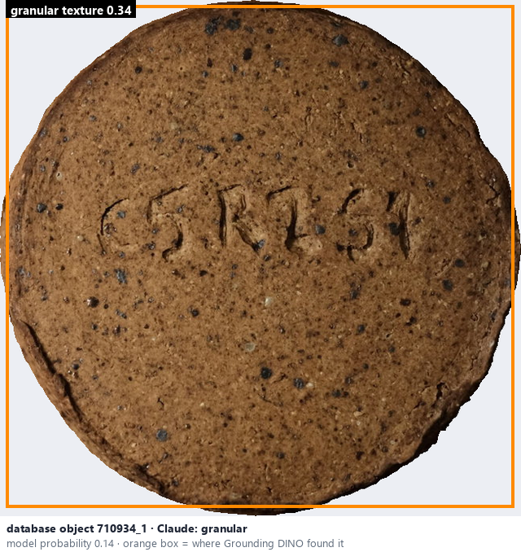
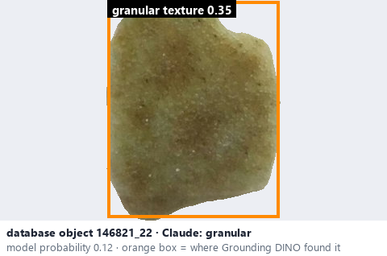

# Granular · Sần hạt

*surface texture* = **granular**

## Identifying features
- Visible grains, bumps, or uneven microstructure.
- This project splits the manual's 'Rough / Granular': granular = distinct small grains, sand-like.

**Recognition:** Irregular fine shadows and grain-like features.

*Source:* Ceramic Attribute Taxonomy (craze documentaries.pdf) p.5 (value 'Rough / Granular')

## Do not confuse with
- **rough** - Rough = uneven bumpy relief without separate grains (the split is this project's vocabulary). *(general description - not defined in your reference manuals)*
- **speckled** - Speckles are coloured dots in a smooth glaze, not raised grains. *(Ceramic Attribute Taxonomy (craze documentaries.pdf) p.7)*

## Images
  
Granular - reference photo from your manual (Ceramic Attribute Taxonomy (craze documentaries.pdf) p.5)
  
database object 710934_1: Claude's label is granular; model probability 0.14; box = Grounding DINO phrase 'granular texture'
  
database object 146821_22: Claude's label is granular; model probability 0.12; box = Grounding DINO phrase 'granular texture'
