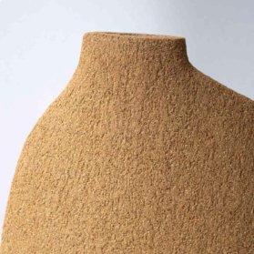
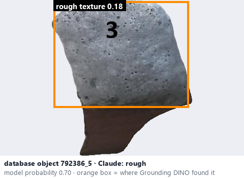
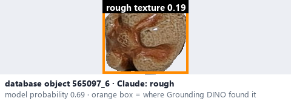

# Rough · Thô

*surface texture* = **rough**

## Identifying features
- Visible grains, bumps, or uneven microstructure.
- This project splits the manual's 'Rough / Granular': rough = uneven, bumpy relief.

**Recognition:** Irregular fine shadows and grain-like features.

*Source:* Ceramic Attribute Taxonomy (craze documentaries.pdf) p.5 (value 'Rough / Granular')

## Do not confuse with
- **granular** - Granular = distinct small grains like sand (the split is this project's vocabulary). *(general description - not defined in your reference manuals)*
- **stony matte** - Stony matte is a finish (low sheen, stone-like); rough is texture - keep the two attributes separate. *(Ceramic_Real_Photo_Comparison_Guide_V4.pdf §7)*

## Images
  
Rough - reference photo from your manual (Ceramic Attribute Taxonomy (craze documentaries.pdf) p.5)
  
database object 792386_5: Claude's label is rough; model probability 0.70; box = Grounding DINO phrase 'rough texture'
  
database object 565097_6: Claude's label is rough; model probability 0.69; box = Grounding DINO phrase 'rough texture'
