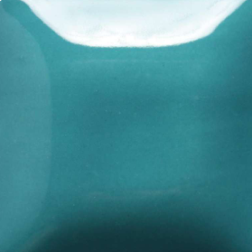
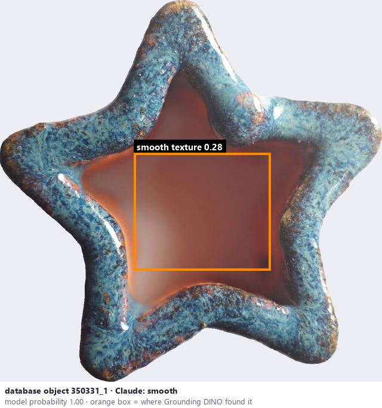
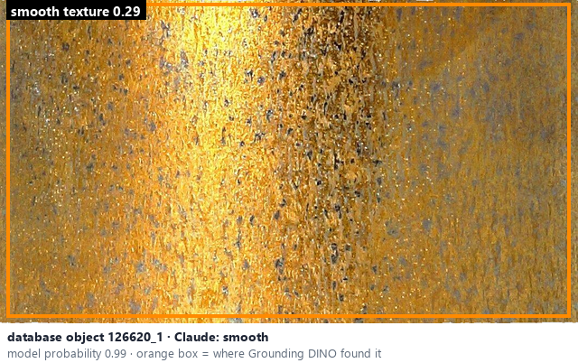

# Smooth · Mịn

*surface texture* = **smooth**

## Identifying features
- Uniform surface with no obvious bumps, ridges, or grains.

**Recognition:** Consistent texture across the ceramic body.

*Source:* Ceramic Attribute Taxonomy (craze documentaries.pdf) p.5

## Do not confuse with
- **rough** - Rough / granular shows grains, bumps or uneven microstructure. *(Ceramic Attribute Taxonomy (craze documentaries.pdf) p.5)*

## Images
  
Smooth - reference photo from your manual (Ceramic Attribute Taxonomy (craze documentaries.pdf) p.5)
  
database object 350331_1: Claude's label is smooth; model probability 1.00; box = Grounding DINO phrase 'smooth texture'
  
database object 126620_1: Claude's label is smooth; model probability 0.99; box = Grounding DINO phrase 'smooth texture'
