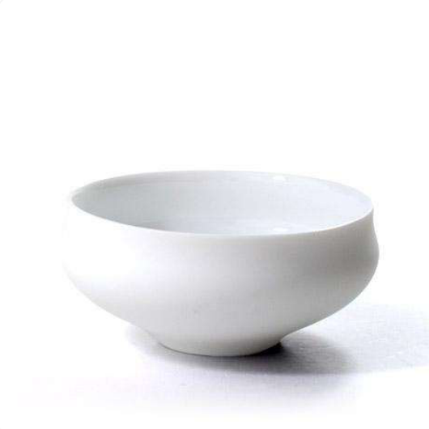
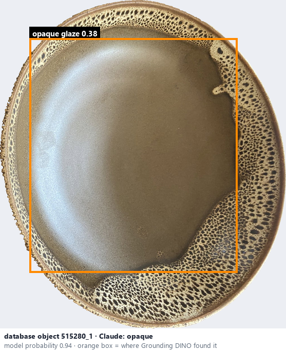
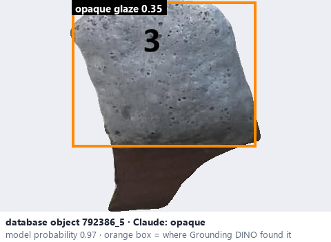

# Opaque · Đục

*transparency* = **opaque**

## Identifying features
- Underlying clay is visually concealed.
- Underlying clay body or decoration is visually concealed.

**Recognition:** A white body colour does not prove an opaque glaze; glossy highlights do not prove a transparent glaze.

*Source:* Ceramic Attribute Taxonomy (craze documentaries.pdf) p.6 · Glaze_Effects_Defects_Surface_Transparency_Reference_v2.pdf p.3

## Do not confuse with
- **translucent** - Translucent lets some detail through, diffusely. *(Ceramic_Real_Photo_Comparison_Guide_V4.pdf §8)*

## Images
  
Opaque - reference photo from your manual (Ceramic Attribute Taxonomy (craze documentaries.pdf) p.6)
  
database object 515280_1: Claude's label is opaque; model probability 0.94; box = Grounding DINO phrase 'opaque glaze'
  
database object 792386_5: Claude's label is opaque; model probability 0.97; box = Grounding DINO phrase 'opaque glaze'
