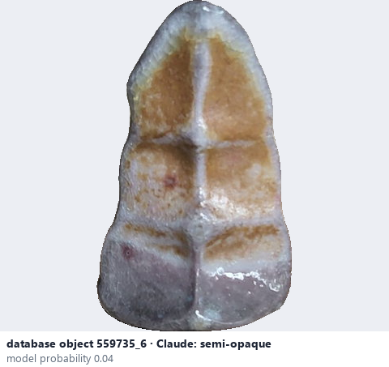
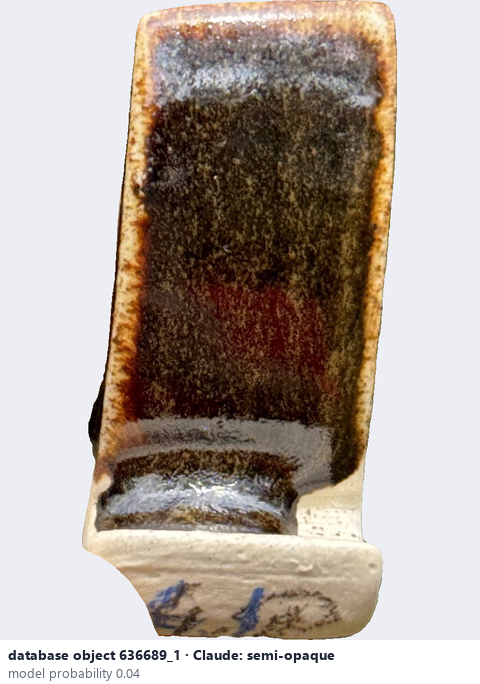

# Semi-opaque

*transparency* = **semi-opaque**

## Identifying features
- Mostly conceals the clay body; a faint hint of what is below may show at thin edges.
- Between translucent and opaque.

**Recognition:** Use when the body is hidden almost everywhere but not completely.

*Source:* general description - not defined in your reference manuals

## Do not confuse with
- **opaque** - Opaque hides the body completely (your manuals have no semi-opaque value). *(general description - not defined in your reference manuals)*

## Images
  
database object 559735_6: Claude's label is semi-opaque; model probability 0.04; no box: the model does not propose this value in its top 3
  
database object 636689_1: Claude's label is semi-opaque; model probability 0.04; no box: the model does not propose this value in its top 3
