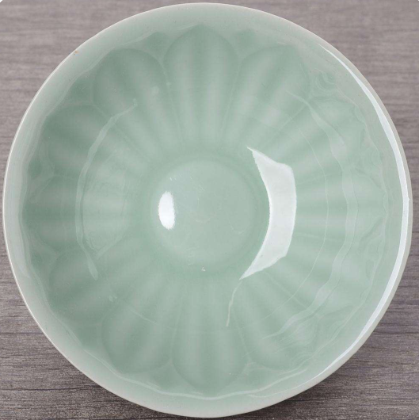
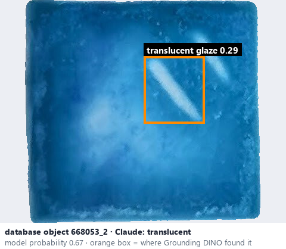
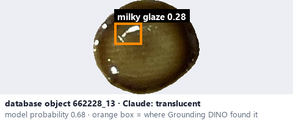

# Translucent · Bán trong

*transparency* = **translucent**

## Identifying features
- Some underlying details are softened or obscured.
- Some light or underlying detail passes through, but details are diffuse.

**Recognition:** Partial, blurred visibility of what is under the glaze.

*Source:* Ceramic Attribute Taxonomy (craze documentaries.pdf) p.6 · Glaze_Effects_Defects_Surface_Transparency_Reference_v2.pdf p.3

## Do not confuse with
- **transparent** - Transparent shows the details clearly; translucent only diffusely. *(Ceramic_Real_Photo_Comparison_Guide_V4.pdf §8)*
- **opaque** - Opaque conceals the underlying material. *(Ceramic_Real_Photo_Comparison_Guide_V4.pdf §8)*

## Images
  
Translucent - reference photo from your manual (Ceramic Attribute Taxonomy (craze documentaries.pdf) p.6)
  
database object 668053_2: Claude's label is translucent; model probability 0.67; box = Grounding DINO phrase 'translucent glaze'
  
database object 662228_13: Claude's label is translucent; model probability 0.68; box = Grounding DINO phrase 'milky glaze'
