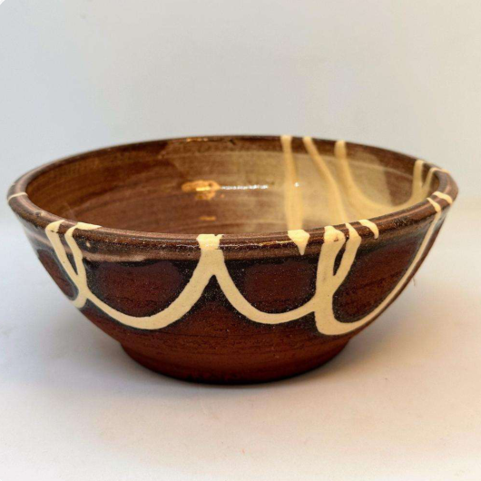
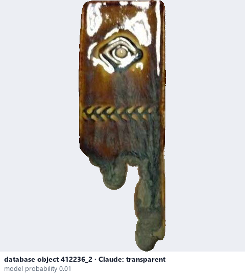
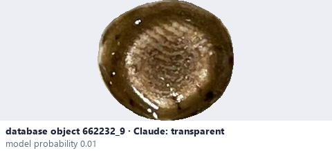

# Transparent · Trong suốt

*transparency* = **transparent**

## Identifying features
- Clay colour and details remain visible.
- Underlying clay colour, lines or decoration can be seen clearly through the glaze.

**Recognition:** Examine whether clay colour, carved details or underlying decoration can be seen through the glaze; opacity is hard to judge from one image without context.

*Source:* Ceramic Attribute Taxonomy (craze documentaries.pdf) p.6 · Glaze_Effects_Defects_Surface_Transparency_Reference_v2.pdf p.3

## Do not confuse with
- **translucent** - Transparent: underlying details clearly visible; translucent: diffuse partial visibility. *(Ceramic_Real_Photo_Comparison_Guide_V4.pdf §8)*

## Images
  
Transparent - reference photo from your manual (Ceramic Attribute Taxonomy (craze documentaries.pdf) p.6)
  
database object 412236_2: Claude's label is transparent; model probability 0.01; no box: the model does not propose this value in its top 3
  
database object 662232_9: Claude's label is transparent; model probability 0.01; no box: the model does not propose this value in its top 3
